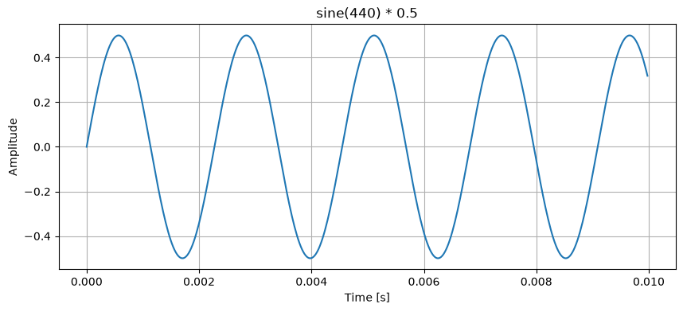

# SymSound

$$
\begin{aligned}
d(t) ={}& 0.8\Bigl( \left(\left\lfloor \tfrac{7t}{3} + 1 \right\rfloor - \tfrac{7t}{3}\right)^{1/2} \sin(80\pi t) \\
&+ 0.25 \left(\left\lfloor \tfrac{7t}{3} + \tfrac{3}{2} \right\rfloor - \tfrac{7t}{3} - \tfrac{1}{2}\right)^{20} n(t) \\
&+ 0.2 \left(\left\lfloor \tfrac{7t}{12} + \tfrac{3}{2} \right\rfloor - \tfrac{7t}{12} - \tfrac{1}{2}\right)^{9}
\bigl(1000t - \lfloor 1000t + \tfrac{1}{2} \rfloor\bigr)
\left(\mathrm{sgn}\sin\!\Bigl(2\pi\bigl(12.5\,t - \tfrac{36}{7\pi}\cos\tfrac{7\pi t}{6}\bigr)\Bigr) + 1\right)\Bigr)
\end{aligned}
$$

> Equation from `./examples/house.py`,
> where $n(t) \sim U(-1, 1)$ is white noise, a new random value at every sample.

A mathematical and programmatic audio engine. Signals are
[SymPy](https://www.sympy.org) expressions of a single shared time symbol,
`symsound.waves.time.TIME`. Oscillators, envelopes, LFOs and time shifts are all
plain algebra, and an expression is only turned into samples when you play,
save or plot it.

```python
from symsound.waves.basic import sine
from symsound.waves.utils import compile, plot

tone = sine(440) * 0.5
samples = compile(tone, duration=1.0)
print(samples.shape, round(float(samples.max()), 3))
plot(tone, duration=0.01, title="sine(440) * 0.5",
     output_file="docs/img/readme-tone.png")
```
<!-- md-code: id="readme-tone"; bin="python3" -->

Output:
```
(44100,) 0.5

```
<!-- md-code-output: id="readme-tone" -->



To hear it, `play` it:

```python no-run
from symsound.waves.basic import sine
from symsound.waves.utils import play

play(sine(440) * 0.5, duration=2.0)
```

<!-- md-toc: -->
- [Why this exists](#why-this-exists)
- [How it works](#how-it-works)
- [Running the examples](#running-the-examples)
- [Documentation](#documentation)
- [Development](#development)
- [Known limitations](#known-limitations)
- [License](#license)
<!-- md-toc: end -->

## Why this exists

SymSound was written to explore how audio works under the hood, at a mathematical
level: a sound is a function of time, an envelope is a piece of algebra, a
filter is a differential equation, and an echo is a sum of delays. It is a place
to read, run and change those ideas, and it favours being clear over being fast.
It is a learning project, not a tool for making audio in practice.

It was written with AI assistance (Claude Code).

## How it works

1. Build an expression: `sine(440) * 0.5`, `square(lfo)`, `adsr_envelope(...)`.
2. `compile(expr, duration, sample_rate)` runs `sympy.lambdify` over a NumPy
   time axis and returns a sample array.
3. `play`, `save` (WAV via `soundfile`) and `plot` call `compile` for you.

Frequencies may themselves be expressions (e.g. `sine(440 + 5 * sine(6))`).
The phase is obtained by integrating the frequency over `TIME`, so frequency
modulation stays correct.

## Running the examples

```sh
python examples/house.py
python examples/house_with_low_pass.py
python examples/ode_to_joy.py
python examples/echo_pulse.py       # asks how many seconds between the echoes
python examples/echo_melody.py      # three plucks: dry, with an echo, in a room
python examples/stereo_placed.py     # three plucks: left, centre, right
python examples/stereo_ping_pong.py  # an echo that bounces between the ears
python examples/stereo_sweep.py      # a chord that sweeps from ear to ear
python examples/keyboard_synth.py   # a playable instrument (needs the gui extra)
```

The dev shell puts `src/` on `PYTHONPATH`. Outside it, install the package with
`pip install -e .` first.

Playback needs [PortAudio](https://www.portaudio.com) via `sounddevice`.
`sounddevice` is only imported when `play` is called, so compiling, saving and
the test suite work on machines without an audio backend.

## Documentation

See [docs/](docs/README.md) for how to use each piece, with graphs of the
signals and a line-by-line walkthrough of `examples/house.py`. The code blocks
in the docs, and the one above, are run by
[mdutils](https://github.com/zamlz/mdutils) (`md`, provided by the dev shell),
which also draws the graphs:

```sh
nix develop -c python tools/build_docs.py          # regenerate output and graphs
nix develop -c python tools/build_docs.py --check  # fail if they are stale
```

How the source code is organised is described in [guidelines.md](guidelines.md)
(section 3, "Project layout").

## Development

The Nix flake provides a dev shell with Python, the project dependencies and
the tooling below:

```sh
nix develop
```

or run a single command without entering the shell, e.g.
`nix develop -c pytest`.

Without Nix, install the package in editable mode with the dev extras:

```sh
pip install -e '.[develop]'
```

| Task | Command |
| --- | --- |
| Run tests | `pytest` (add `-m "not slow"` to skip the examples) |
| Lint | `ruff check .` |
| Format | `ruff format tests` |
| Type check | `mypy src/symsound` |

Tool settings live in `pyproject.toml` (ruff, mypy, pytest).

`nix flake check` runs the tests, ruff, mypy and the docs check in the Nix
sandbox. GitHub Actions (`.github/workflows/ci.yml`) runs the same tools on every
push to `main` and every pull request, each as its own job so they run side by
side: ruff check, ruff format, mypy, pytest (spread over the CPUs with
pytest-xdist) and the docs check, plus a cheap evaluation of the flake. A final
`check` job passes only when all of them did, and is the one the rules on `main`
require. The slow mutation check runs nightly and on demand from the Actions tab
(`mutation.yml`).

Every change, new feature and fixed bug needs rigorous tests. The standard,
per-feature checklists and conventions are in [guidelines.md](guidelines.md).

## Known limitations

- A filtered signal can only be evaluated over a uniform grid of sample
  times (which is what `compile`, `play` and `save` use), not at a single
  time, and the filter starts at rest at the first sample.
- White noise is a single shared symbol, so every use of `WHITE_NOISE` in one
  expression sees the same samples.

## License

SymSound is free software under the GNU General Public License, version 3 or (at
your option) any later version. See [LICENSE](LICENSE). It comes with no
warranty.
