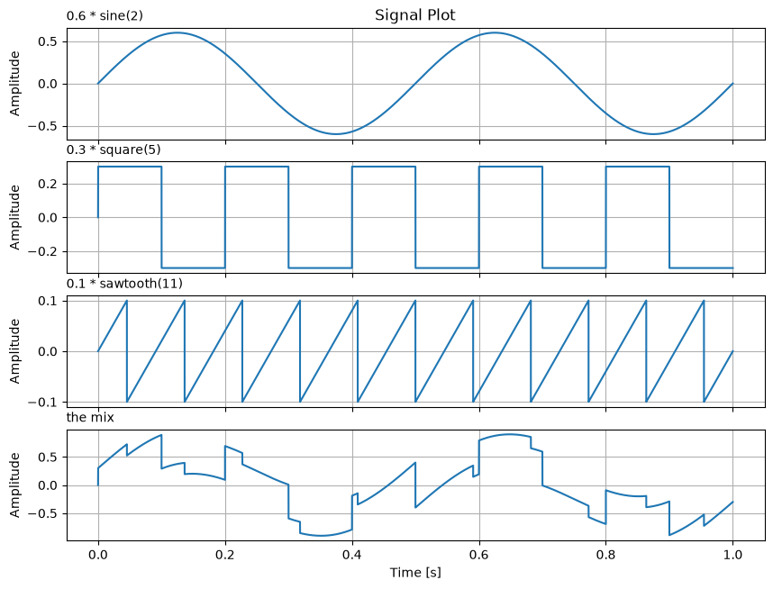
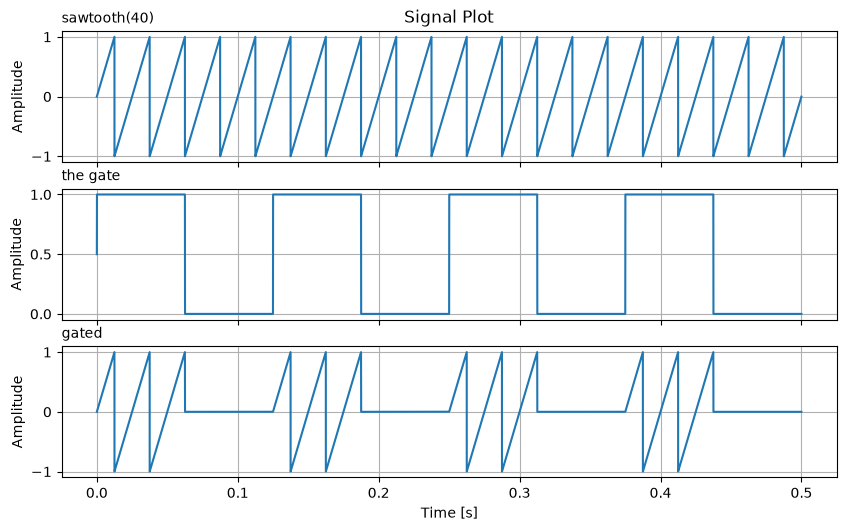
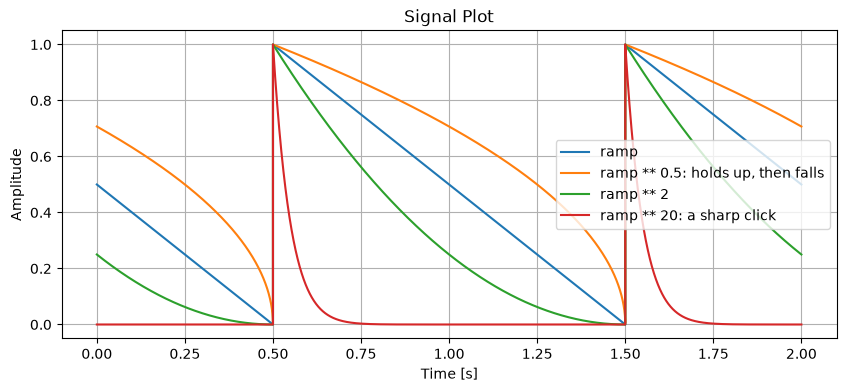
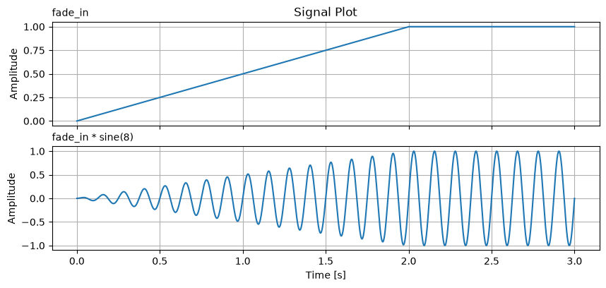
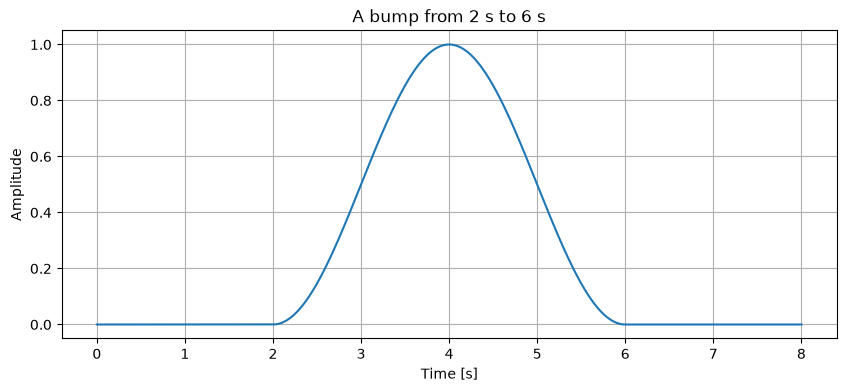
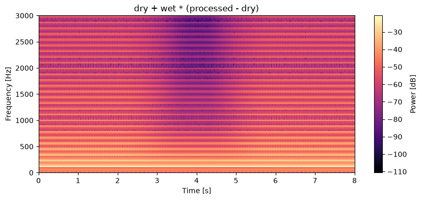
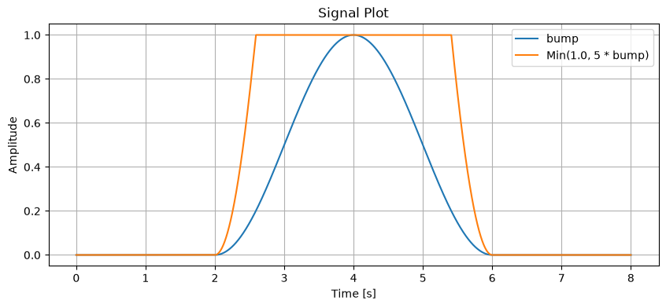

# Combining signals

<!-- md-toc: -->
- [Mixing](#mixing)
- [Gating: on and off](#gating-on-and-off)
- [A decay that repeats](#a-decay-that-repeats)
- [Fading with a time window](#fading-with-a-time-window)
- [A bump that rises and falls: `sin²`](#a-bump-that-rises-and-falls-sin²)
- [Crossfading between a dry and a processed signal](#crossfading-between-a-dry-and-a-processed-signal)
- [Reaching full strength sooner](#reaching-full-strength-sooner)
<!-- md-toc: end -->

Everything in this library is algebra on signals, so a handful of patterns cover
most of what you want to build. The graphs use slow frequencies so the shapes
are visible.

## Mixing

Add signals, and scale each to set its level. The weights should add up to
about 1 or less so the mix does not clip:

```python
from symsound.waves.basic import sawtooth, sine, square
from symsound.waves.utils import plot

parts = [0.6 * sine(2), 0.3 * square(5), 0.1 * sawtooth(11)]
mix = sum(parts)
plot(parts + [mix], duration=1.0,
     labels=["0.6 * sine(2)", "0.3 * square(5)", "0.1 * sawtooth(11)", "the mix"],
     stacked=True, output_file="img/combining-mix.png")
```
<!-- md-code: id="combining-mix"; bin="python3" -->



## Gating: on and off

Multiply by something that is 1 (let through) or 0 (silence). `square` runs
between -1 and 1, so `(square + 1) / 2` runs between 0 and 1:

```python
from symsound.waves.basic import sawtooth, square
from symsound.waves.utils import plot

gate = (square(8) + 1) / 2          # on for half of each cycle, 8 cycles a second
gated = sawtooth(40) * gate
plot([sawtooth(40), gate, gated], duration=0.5,
     labels=["sawtooth(40)", "the gate", "gated"], stacked=True,
     output_file="img/combining-gate.png")
```
<!-- md-code: id="combining-gate"; bin="python3" -->



`trigger(t)` is a one-way gate.

## A decay that repeats

A sawtooth ramps from -1 to 1 and jumps back. Flipping and squashing it gives a
ramp from 1 down to 0 that restarts every cycle. Raising the ramp to a power
bends it: a large power makes the sound die away quickly after each hit, a power
below 1 makes it linger and then drop.

```python
from symsound.waves.basic import sawtooth
from symsound.waves.utils import plot

ramp = (1 - sawtooth(1)) / 2         # 1 falling to 0 over each second
plot([ramp, ramp ** 0.5, ramp ** 2, ramp ** 20], duration=2.0,
     labels=["ramp", "ramp ** 0.5: holds up, then falls",
             "ramp ** 2", "ramp ** 20: a sharp click"],
     output_file="img/combining-decay.png")
```
<!-- md-code: id="combining-decay"; bin="python3" -->



Multiply this by a tone or noise and you have a repeating drum hit.

## Fading with a time window

`sp.Piecewise` selects different expressions in different time ranges. The first
true condition wins and `True` means "otherwise". Join conditions with
`sp.And`, `sp.Or`, not Python's `and`/`or`:

```python
import sympy as sp

from symsound.waves.basic import sine
from symsound.waves.time import TIME
from symsound.waves.utils import plot

fade_in = sp.Piecewise(
    (TIME / 2, TIME <= 2),      # rises from 0 to 1 over two seconds
    (1.0, True),                # then stays at 1
)
swelling = fade_in * sine(8)
plot([fade_in, swelling], duration=3.0, labels=["fade_in", "fade_in * sine(8)"],
     stacked=True, output_file="img/combining-fade.png")
```
<!-- md-code: id="combining-fade"; bin="python3" -->



## A bump that rises and falls: `sin²`

`sin(pi * x) ** 2` goes 0, up to 1 at `x = 0.5`, and back to 0 at `x = 1`, with
smooth edges. Put a time window around it and you have a smooth "bump" signal
that is 0 everywhere else. This is the heart of `house_with_low_pass.py`:

```python
import sympy as sp

from symsound.waves.time import TIME
from symsound.waves.utils import plot

start, length = 2.0, 4.0
bump = sp.Piecewise(
    (
        sp.sin(sp.pi * (TIME - start) / length) ** 2,
        sp.And(TIME >= start, TIME <= start + length),
    ),
    (0.0, True),
)
plot(bump, duration=8.0, title="A bump from 2 s to 6 s",
     output_file="img/combining-bump.png")
```
<!-- md-code: id="combining-bump"; bin="python3" -->



`bump` is 0 before 2 s, rises smoothly to 1 at 4 s, falls back to 0 at 6 s, and
stays 0 afterwards.

## Crossfading between a dry and a processed signal

To blend between a signal and a processed copy of it, use a blend amount `wet`
between 0 (all original) and 1 (all processed). Here the processed copy is the
sawtooth through a low-pass filter, and `wet` is the bump above:

```python
import sympy as sp

from symsound.filters import low_pass_filter
from symsound.waves.basic import sawtooth
from symsound.waves.time import TIME
from symsound.waves.utils import spectrogram

start, length = 2.0, 4.0
wet = sp.Piecewise(
    (
        sp.sin(sp.pi * (TIME - start) / length) ** 2,
        sp.And(TIME >= start, TIME <= start + length),
    ),
    (0.0, True),
)
dry = sawtooth(110)
processed = low_pass_filter(dry, 300)

result = dry + wet * (processed - dry)
spectrogram(result, duration=8.0, max_frequency=3000,
            title="dry + wet * (processed - dry)",
            output_file="img/combining-crossfade.png")
```
<!-- md-code: id="combining-crossfade"; bin="python3" -->



The upper harmonics fade out as `wet` rises towards 4 s and return as it falls.
Before 2 s and after 6 s they are untouched.

When `wet` is 0 the result is exactly `dry`. When `wet` is 1 it is exactly
`processed`. In between it is a proportional mix. Written like this the
original appears once and the processed copy once.

Why blend rather than just switching the filter on? With `wet` at 0 outside the
bump, the sound before and after is *exactly* the original: no filter delay, no
leftover. With the filter always on, even a wide-open cutoff changes the sound a
little.

## Reaching full strength sooner

`sp.Min(1.0, k * bump)` rises `k` times faster than `bump` and then stops at 1.
Use it to make the blend reach full strength early, so the processed sound is
fully there for most of the bump:

```python
import sympy as sp

from symsound.waves.time import TIME
from symsound.waves.utils import plot

start, length = 2.0, 4.0
bump = sp.Piecewise(
    (
        sp.sin(sp.pi * (TIME - start) / length) ** 2,
        sp.And(TIME >= start, TIME <= start + length),
    ),
    (0.0, True),
)
quick_wet = sp.Min(1.0, 5 * bump)
plot([bump, quick_wet], duration=8.0, labels=["bump", "Min(1.0, 5 * bump)"],
     output_file="img/combining-quick.png")
```
<!-- md-code: id="combining-quick"; bin="python3" -->


