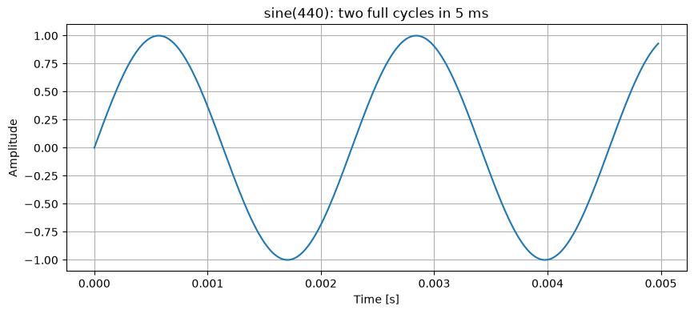
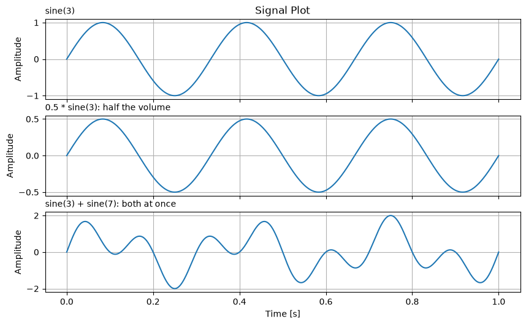
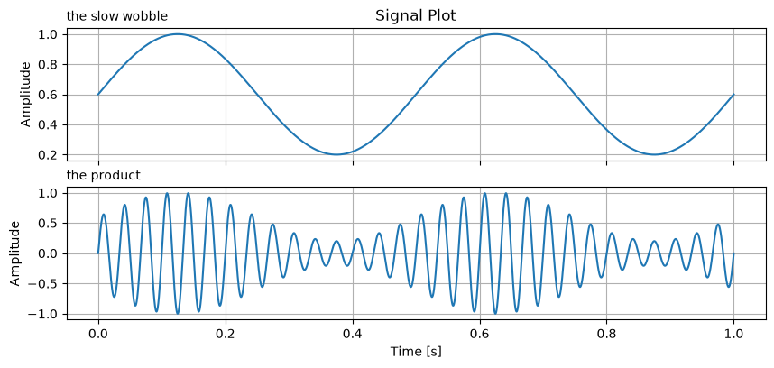
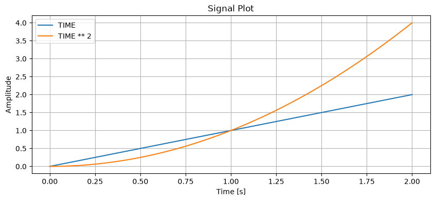
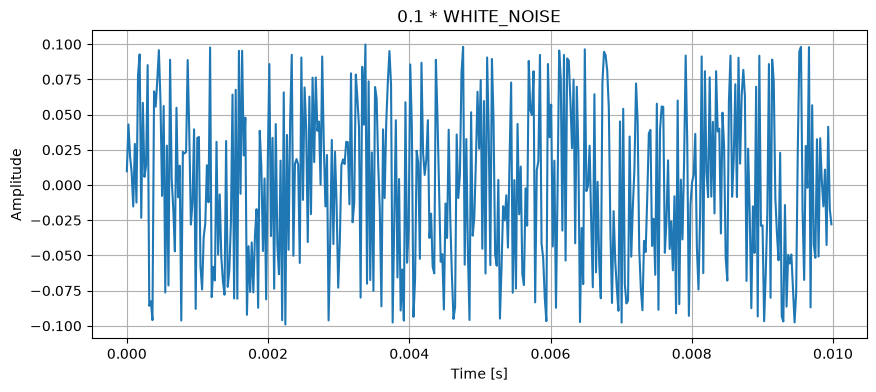
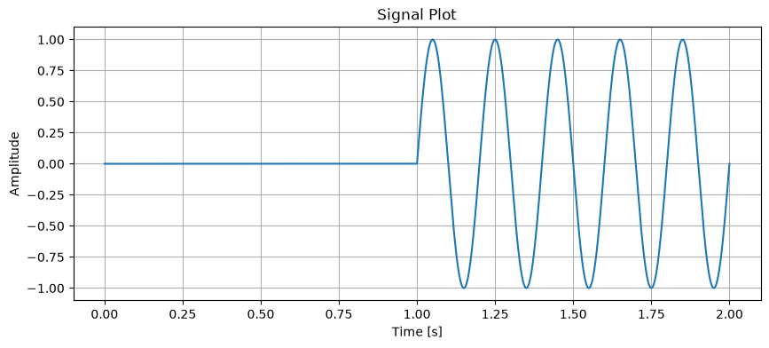

# Concepts

<!-- md-toc: -->
- [A signal is a formula](#a-signal-is-a-formula)
- [Amplitude](#amplitude)
- [`TIME`](#time)
- [From expression to sound](#from-expression-to-sound)
- [Noise](#noise)
- [Piecewise expressions](#piecewise-expressions)
<!-- md-toc: end -->

## A signal is a formula

In this library a sound is not a list of samples. It is a mathematical
expression of one symbol, `TIME`, the time in seconds:

```python
from daw.waves.basic import sine

tone = sine(440)
print(tone)
```
<!-- md-code: id="concepts-formula"; bin="python3" -->

Output:
```
sin(880*pi*time)

```
<!-- md-code-output: id="concepts-formula" -->

`sine(440)` is the expression `sin(880.0*pi*time)`: 440 cycles per second.
Nothing has been computed yet. Here are the first 5 milliseconds of it, drawn
with `plot` (see [Playing, saving and plotting](output.md)):

```python
from daw.waves.basic import sine
from daw.waves.utils import plot

plot(sine(440), duration=0.005, title="sine(440): two full cycles in 5 ms",
     output_file="img/concepts-sine-440.png")
```
<!-- md-code: id="concepts-sine-440"; bin="python3" -->



Because it is an expression you can do algebra with it. Adding signals mixes
them. Multiplying a signal by a number changes its volume. Multiplying two
signals shapes one with the other, which is how envelopes and low-frequency
oscillators (LFOs) work. The graphs below use slow frequencies (3 and 7 Hz) so
you can see the shapes; the idea is the same at audio frequencies.

```python
from daw.waves.basic import sine
from daw.waves.utils import plot

plot(
    [sine(3), 0.5 * sine(3), sine(3) + sine(7)],
    duration=1.0,
    labels=["sine(3)", "0.5 * sine(3): half the volume",
            "sine(3) + sine(7): both at once"],
    stacked=True,
    output_file="img/concepts-algebra.png",
)
```
<!-- md-code: id="concepts-algebra"; bin="python3" -->



Multiplying two signals is how you make the volume wobble (tremolo): the slow
signal `0.6 + 0.4 * sine(2)` swings between 0.2 and 1.0 and scales the fast one.

```python
from daw.waves.basic import sine
from daw.waves.utils import plot

wobble = 0.6 + 0.4 * sine(2)
tremolo = sine(30) * wobble
plot([wobble, tremolo], duration=1.0, labels=["the slow wobble", "the product"],
     stacked=True, output_file="img/concepts-tremolo.png")
```
<!-- md-code: id="concepts-tremolo"; bin="python3" -->



## Amplitude

Signals are expected to stay between -1 and 1. Anything beyond that clips when
played or saved. Mixing several loud signals can add up past 1, so scale the
sum down, for example `0.3 * (a + b + c)`.

## `TIME`

`TIME` is one shared symbol, `daw.waves.time.TIME`. Every function in the
library builds its expressions from it, so they all line up on the same clock.
Time zero is the start of the audio. You can use it directly: `TIME` on its own
is a signal that rises by one every second, and `TIME ** 2` bends upward.

```python
from daw.waves.time import TIME
from daw.waves.utils import plot

plot([TIME, TIME ** 2], duration=2.0, labels=["TIME", "TIME ** 2"],
     output_file="img/concepts-time.png")
```
<!-- md-code: id="concepts-time"; bin="python3" -->



## From expression to sound

An expression only becomes audio when you ask for it:

```python
from daw.waves.basic import sine
from daw.waves.utils import compile

samples = compile(sine(440), duration=1.0)   # a NumPy array
print(len(samples))                          # 44100 samples: one second at 44.1 kHz
print(samples[:4].round(4))                  # the first few
```
<!-- md-code: id="concepts-compile"; bin="python3" -->

Output:
```
44100
[0.     0.0626 0.1251 0.187 ]

```
<!-- md-code-output: id="concepts-compile" -->

`compile` evaluates the expression at 44100 evenly spaced times per second
(`DEFAULT_SAMPLE_RATE`), starting at time zero. `play`, `save` and `plot` call
it for you. See [Playing, saving and plotting](output.md).

## Noise

`daw.waves.utils.WHITE_NOISE` is a second symbol. When compiled it becomes a
fresh random value in [-1, 1] for every sample:

```python
import numpy as np

from daw.waves.utils import WHITE_NOISE, plot

np.random.seed(0)    # makes the noise the same every run, so this graph is too
plot(0.1 * WHITE_NOISE, duration=0.01, title="0.1 * WHITE_NOISE",
     output_file="img/concepts-noise.png")
```
<!-- md-code: id="concepts-noise"; bin="python3" -->



Every use of `WHITE_NOISE` inside one expression sees the *same* random
samples. So `WHITE_NOISE - WHITE_NOISE` is exactly zero, not two independent
noises.

## Piecewise expressions

Anything that changes behaviour at a certain time is written with SymPy's
`Piecewise`. It reads like an if/elif list: the first condition that is true
wins, and `True` means "otherwise".

```python
import sympy as sp

from daw.waves.basic import sine
from daw.waves.time import TIME
from daw.waves.utils import plot

# silent until one second, then a tone
late_tone = sp.Piecewise(
    (0.0, TIME < 1),
    (sine(5), True),
)
plot(late_tone, duration=2.0, output_file="img/concepts-piecewise.png")
```
<!-- md-code: id="concepts-piecewise"; bin="python3" -->



The library's envelopes, `trigger` and the sweep in `kick.py` are all built
this way. See [Combining signals](combining.md).
