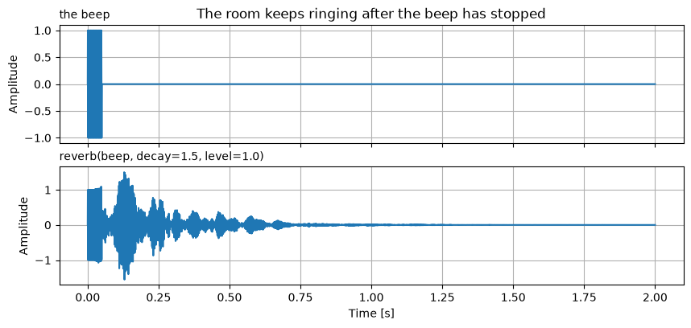
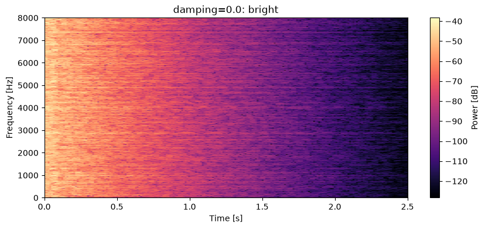
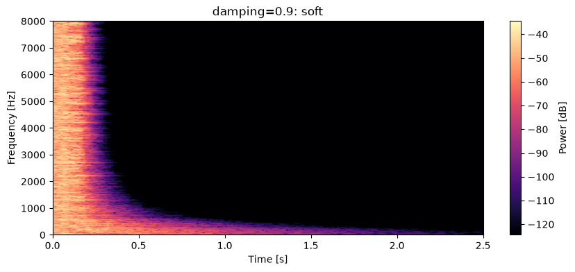

# Echo and reverb

<!-- md-toc: -->
- [Echo](#echo)
- [Reverb](#reverb)
- [Using them with the rest](#using-them-with-the-rest)
- [The limits](#the-limits)
- [Under the hood](#under-the-hood)
<!-- md-toc: end -->

An effect takes a sound and puts its own past back on top of it. `daw.effects`
has two:

| Function | What it does |
| --- | --- |
| `echo(signal, delay=0.3, feedback=0.5, level=0.5)` | Repeats the sound after `delay` seconds, again and again, each repeat quieter |
| `reverb(signal, decay=1.5, level=0.3, damping=0.5)` | Puts the sound in a room: a dense wash that dies away over `decay` seconds |

Both return an ordinary signal expression. Mix it, scale it, shift it, filter it
or put another effect on it, like any other. Both work over a whole run of
samples, so they are for `compile`, `play`, `save`, `plot` and `visualize`,
and not for the live [keyboard](keyboard.md) (see [the limits](#the-limits)).

## Echo

```python
import sympy as sp

from daw.effects import echo
from daw.waves.basic import sine
from daw.waves.time import TIME
from daw.waves.utils import plot

# A short beep: 440 Hz for 50 ms, silent either side
beep = sine(440) * sp.Piecewise((1, (TIME >= 0) & (TIME < 0.05)), (0, True))
plot([beep, echo(beep, delay=0.25, feedback=0.5, level=0.8)], duration=1.0,
     labels=["the beep", "echo(beep, delay=0.25, feedback=0.5, level=0.8)"],
     stacked=True, title="Each repeat is a copy of the beep, quieter",
     output_file="img/effects-echo.png")
```
<!-- md-code: id="effects-echo"; bin="python3" -->


The three settings:

- `delay` is the time between repeats, in seconds. It is rounded to a whole
  number of samples.
- `level` is how loud the first repeat is next to the sound itself (0.8 is 80%).
- `feedback` is how much quieter each repeat is than the one before: 0.5 halves
  it every time. It must be at least 0 and less than 1, or the echoes would
  never die away. With `feedback=0` there is exactly one repeat.

So repeat number `k` comes `k * delay` seconds later at `level * feedback**(k - 1)`
times the height of the sound. In the graph: 0.8, 0.4, 0.2.

An echo that is a whole number of periods long reinforces a steady tone, and one
that is half a period out cancels part of it. That is why `echo` on a held note
can change how loud it is. For a steady sine, the height with a whole-period
delay is `1 + level / (1 - feedback)`.

## Reverb

A room does not send back a few clean copies. Sound bounces between the walls
thousands of times, and what you hear is a smooth tail. `reverb` builds that
tail the classic way (Manfred Schroeder's design, with the delay lengths of the
Freeverb program): eight comb filters side by side give the tail its body, and
four all-pass filters in a row blur it into a smooth wash.

```python
import sympy as sp

from daw.effects import reverb
from daw.waves.basic import sine
from daw.waves.time import TIME
from daw.waves.utils import plot

beep = sine(440) * sp.Piecewise((1, (TIME >= 0) & (TIME < 0.05)), (0, True))
plot([beep, reverb(beep, decay=1.5, level=1.0)], duration=2.0,
     labels=["the beep", "reverb(beep, decay=1.5, level=1.0)"],
     stacked=True, title="The room keeps ringing after the beep has stopped",
     output_file="img/effects-reverb.png")
```
<!-- md-code: id="effects-reverb"; bin="python3" -->



The settings:

- `decay` is how long the room rings, as the time for the tail to fall 60 dB
  (to a thousandth of its height), which is the usual measure of a room.
  A bathroom is under a second, a hall is two or three.
- `level` is how loud the reverb is next to the dry sound. The reverb is scaled
  so that white noise through it comes out as loud as it went in, so `level=1`
  is "as much room as sound" for any `decay`.
- `damping`, from 0 up to (not including) 1, makes the high frequencies fade
  faster than the low ones, like soft walls and curtains. 0 is a bare, bright
  room; the default of 0.5 is natural.

The next graph measures the claim about `decay`. It takes the room's sound
for one click (`reverb_impulse_response`) and plots how much of its energy is
left at each moment:

```python
import matplotlib.pyplot as plt
import numpy as np

from daw.effects import reverb_impulse_response

rate = 44100
fig, ax = plt.subplots(figsize=(10, 4))
for decay in (0.5, 1.5, 3.0):
    response = reverb_impulse_response(decay, damping=0.0, sample_rate=rate)
    left = np.cumsum((response**2)[::-1])[::-1]
    ax.plot(np.arange(len(response)) / rate, 10 * np.log10(left / left[0]),
            label=f"decay={decay}")
    ax.axvline(decay, color="gray", linestyle=":")
ax.axhline(-60, color="gray", linestyle="--")
ax.set_ylim(-90, 3)
ax.set_xlabel("Time [s]")
ax.set_ylabel("Energy still to come [dB]")
ax.set_title("Each room falls 60 dB at its decay time")
ax.grid(True, alpha=0.4)
ax.legend()
fig.savefig("img/effects-decay.png", dpi=100, bbox_inches="tight")
```
<!-- md-code: id="effects-decay"; bin="python3" -->


Each line crosses the dashed -60 dB line at the dotted line of its own `decay`.

Damping shows best in a spectrogram. Both rooms below ring for two seconds
after the same short noise burst, but in the damped one the highs are gone
within a moment while the lows keep going:

```python
import numpy as np
import sympy as sp

from daw.effects import reverb
from daw.waves.time import TIME
from daw.waves.utils import WHITE_NOISE, spectrogram

np.random.seed(0)    # the burst is noise: seed it so these pictures are the same every run
hiss = WHITE_NOISE * sp.Piecewise((1, (TIME >= 0) & (TIME < 0.1)), (0, True))
spectrogram(reverb(hiss, decay=2.0, level=1.0, damping=0.0), duration=2.5,
            max_frequency=8000, title="damping=0.0: bright",
            output_file="img/effects-spec-bright.png")
spectrogram(reverb(hiss, decay=2.0, level=1.0, damping=0.9), duration=2.5,
            max_frequency=8000, title="damping=0.9: soft",
            output_file="img/effects-spec-soft.png")
```
<!-- md-code: id="effects-spectrograms"; bin="python3" -->

| bright | soft |
| --- | --- |
|  |  |

## Using them with the rest

An effect is a signal, so everything in these docs applies to it. A reverb on a
whole song is one line (this is a quiet chord with an echo and a room):

```python
from daw.constants import Note
from daw.effects import echo, reverb
from daw.envelope import ACTIVE_DURATION, adsr_envelope
from daw.waves.basic import sine
from daw.waves.utils import compile

pluck = adsr_envelope(0.005, 0.3, 0.0, 0.1).subs(ACTIVE_DURATION, 0.01)
chord = (sine(Note.C4) + sine(Note.E4) + sine(Note.G4)) / 3 * pluck
wet = reverb(echo(chord, delay=0.4, feedback=0.4, level=0.5), decay=2.0)
samples = compile(wet, duration=4.0)
print(samples.shape, round(float(abs(samples).max()), 2))
```
<!-- md-code: id="effects-chain"; bin="python3" -->

Output:
```
(176400,) 0.9

```
<!-- md-code-output: id="effects-chain" -->

Effects can be stacked in any order. The reverb is applied to everything inside
it, including an echo. With a sound that goes through a filter, put the effect
outside the filter (`reverb(low_pass_filter(...))`) for the filtered sound in the
room, or inside for the room's sound filtered.

To look at it, `visualize(reverb(...), duration=4.0)` plays it in the
[visualizer](visualizing.md) with the tail on the scope and spectrogram.

## The limits

- **Make the sound long enough.** An effect's output is as long as its input:
  `compile(echo(beep, 0.5), 1.0)` is one second, and the repeats that would
  fall after the end are cut. Compile for the length of the sound plus its tail
  (a reverb's `decay`, an echo's `delay` times the repeats you want to hear).
- **Not live.** Like a filter, an effect needs the whole signal from the start,
  so `keyboard` and `NoteSource` raise a `ValueError` for an expression with an
  echo or a reverb in it. Use `visualize`, or `compile` the result.
- **The settings are plain numbers.** They set the lengths inside the effect,
  so they cannot change with time: `echo(x, delay=TIME)` raises a `ValueError`.
  Only the signal itself can be any expression.
- **A single instant cannot be evaluated.** Like a filter, an effect needs a
  run of evenly spaced sample times, which `compile` provides.
- **The echo's repeats are at whole samples.** The delay is rounded to the
  nearest sample, a difference of at most half a sample (11 microseconds at
  44100 Hz).
- **The reverb tail is cut at 90 dB down.** That is far below hearing in a
  room, but it means the response is finite: the tail is gone a little after
  1.5 times `decay`.

## Under the hood

`echo` and `reverb` return `Echo` and `Reverb` expressions, placeholders that
hold the signal and the settings (the same trick as `LowPass`). When the
expression is compiled, the signal is evaluated at every sample time and handed
to `apply_echo(samples, delay, feedback, level, sample_rate)` or
`apply_reverb(samples, decay, level, damping, sample_rate)`. You can call those
on a NumPy array if you already have samples.

`apply_echo` is one recursive filter that feeds each repeat back in at
`feedback`. `apply_reverb` is a convolution with the room's
response, `reverb_impulse_response(decay, damping, sample_rate)`: what comes
out when a single click goes in, with total energy 1. The eight comb filters
have gains chosen so that each falls exactly 60 dB in `decay` seconds, whatever
its length, and `damping` is a low-pass filter inside each comb's loop.
