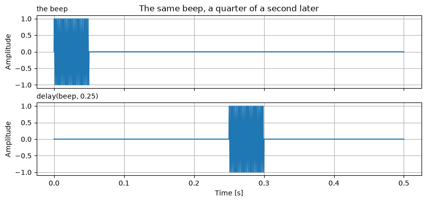
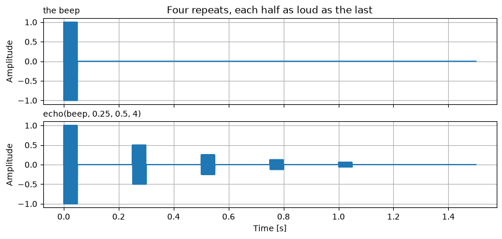
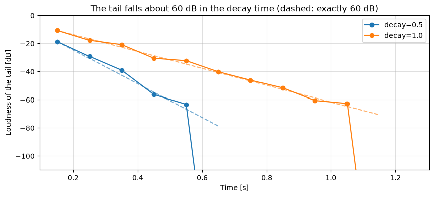

# Delay, echo and reverb

<!-- md-toc: -->
- [Delay](#delay)
- [An echo from delays](#an-echo-from-delays)
- [A reverb from delays](#a-reverb-from-delays)
- [Using them with the rest](#using-them-with-the-rest)
- [The limits](#the-limits)
- [Under the hood](#under-the-hood)
<!-- md-toc: end -->

`daw.effects.delay(signal, seconds)` is a signal, later: the sound as it was
`seconds` ago, and silence until then. It is the one building block. An echo is
a few delayed copies of a sound laid on top of it at even spacings, and a
reverb is thousands at irregular spacings. This page builds both from `delay`,
as ordinary expressions, with no processing hidden behind them.

## Delay

```python
import sympy as sp

from daw.effects import delay
from daw.waves.basic import sine
from daw.waves.time import TIME
from daw.waves.utils import plot

# A short beep: 500 Hz for 50 ms, silent either side
beep = sine(500) * sp.Piecewise((1, (TIME >= 0) & (TIME < 0.05)), (0, True))
plot([beep, delay(beep, 0.25)], duration=0.5,
     labels=["the beep", "delay(beep, 0.25)"], stacked=True,
     title="The same beep, a quarter of a second later",
     output_file="img/effects-delay.png")
```
<!-- md-code: id="effects-delay"; bin="python3" -->



The result is a plain expression of `TIME`. Mix it, scale it, shift it, filter
it, or delay it again like any other. Delaying a delay adds the delays:
`delay(delay(x, a), b)` is `delay(x, a + b)`.

`delay` is silent before the sound arrives, even for a signal that is not
silent before time zero. A sine has values at negative times, and the delayed
sine is still exactly zero until its delay is over.

The delay is a number of seconds, not a number of samples, so it does not
change with the sample rate. It must be a plain number that is not negative.
A delay of `0` gives back the signal itself.

## An echo from delays

An echo is the sound followed by copies of itself, each one quieter than the
one before. A short function builds it out of `delay`:

```python
import sympy as sp

from daw.effects import delay
from daw.waves.basic import sine
from daw.waves.time import TIME
from daw.waves.utils import compile, plot


def echo(signal, spacing, feedback, repeats):
    """The sound, then `repeats` copies at `spacing` seconds, each `feedback`
    times as loud as the one before"""
    return signal + sum(
        feedback**k * delay(signal, k * spacing) for k in range(1, repeats + 1)
    )


beep = sine(500) * sp.Piecewise((1, (TIME >= 0) & (TIME < 0.05)), (0, True))
echoed = echo(beep, spacing=0.25, feedback=0.5, repeats=4)
plot([beep, echoed], duration=1.5,
     labels=["the beep", "echo(beep, 0.25, 0.5, 4)"], stacked=True,
     title="Four repeats, each half as loud as the last",
     output_file="img/effects-echo.png")
print(compile(echoed, 1.5).shape)
```
<!-- md-code: id="effects-echo"; bin="python3" -->

Output:
```
(66150,)

```
<!-- md-code-output: id="effects-echo" -->



Repeat number `k` comes `k * spacing` seconds later at `feedback**k` times the
height. That is the sum, spelled out, so you can change it however you like:
give each copy its own level, space the repeats unevenly, or filter each one
(`low_pass_filter(delay(...), 2000)`) so the repeats get duller.

`examples/echo_pulse.py` is this echo on a short sine pulse. It asks you for the
delay when it starts, so you can hear how the spacing changes the sound: under
about a tenth of a second the repeats blur into a buzz, and past a few tenths
they are separate echoes. `examples/echo_melody.py` plays three plucked notes
placed with `delay`, first dry, then with this echo, then with the reverb below.

An echo is only as long as you build it. `repeats=4` means four copies, and the
fifth is not there. Choose `repeats` so the last copy is quiet enough: with a
`feedback` of 0.5, ten repeats end 60 dB down.

## A reverb from delays

A room does not send back four clean copies. The sound bounces between the walls
thousands of times, and the copies arrive so close together that they blur into
one smooth tail. The same recipe gets there with more copies. This one is the
comb-filter half of Schroeder's classic reverb: eight echoes with slightly
different spacings, written out as delays.

```python
import numpy as np
import sympy as sp

from daw.effects import delay
from daw.waves.basic import sine
from daw.waves.time import TIME
from daw.waves.utils import compile, plot

# Eight spacings, in seconds, with no common factor so the copies never line
# up into a single ringing pitch
SPACINGS = (0.0253, 0.0269, 0.0289, 0.0307, 0.0322, 0.0338, 0.0353, 0.0367)


def reverb(signal, decay=1.0, level=0.3):
    """The sound plus a tail that falls 60 dB in `decay` seconds"""
    wet = 0
    for spacing in SPACINGS:
        # Each trip around one of these loops loses this much, so that the
        # copies are 60 dB (a thousandth) quieter after `decay` seconds
        gain = 10 ** (-3 * spacing / decay)
        wet += sum(
            gain**k * delay(signal, k * spacing)
            for k in range(1, int(decay / spacing) + 1)
        )
    return signal + level * wet / np.sqrt(len(SPACINGS))


beep = sine(500) * sp.Piecewise((1, (TIME >= 0) & (TIME < 0.05)), (0, True))
roomy = reverb(beep, decay=1.0, level=1.0)
plot([beep, roomy], duration=1.5,
     labels=["the beep", "reverb(beep, decay=1.0, level=1.0)"], stacked=True,
     title="The room keeps ringing after the beep has stopped",
     output_file="img/effects-reverb.png")
print(compile(roomy, 1.5).shape)
```
<!-- md-code: id="effects-reverb"; bin="python3" -->

Output:
```
(66150,)

```
<!-- md-code-output: id="effects-reverb" -->


That is about 300 delayed copies of the beep in one expression. The next graph
measures the tail. It takes the loudness of the reverb (the height of the
sound in each tenth of a second) and compares it with a line that falls 60 dB
in `decay` seconds:

```python
import matplotlib.pyplot as plt
import numpy as np
import sympy as sp

from daw.effects import delay
from daw.waves.basic import sine
from daw.waves.time import TIME
from daw.waves.utils import compile

SPACINGS = (0.0253, 0.0269, 0.0289, 0.0307, 0.0322, 0.0338, 0.0353, 0.0367)


def reverb(signal, decay=1.0, level=0.3):
    wet = 0
    for spacing in SPACINGS:
        gain = 10 ** (-3 * spacing / decay)
        wet += sum(
            gain**k * delay(signal, k * spacing)
            for k in range(1, int(decay / spacing) + 1)
        )
    return signal + level * wet / np.sqrt(len(SPACINGS))


rate = 44100
beep = sine(500) * sp.Piecewise((1, (TIME >= 0) & (TIME < 0.05)), (0, True))
fig, ax = plt.subplots(figsize=(10, 4))
for decay in (0.5, 1.0):
    samples = compile(reverb(beep, decay, 1.0), decay + 0.3)
    step = rate // 10
    middle = [(i + 0.5) / 10 for i in range(1, len(samples) // step)]
    loudness = [
        20 * np.log10(np.sqrt(np.mean(samples[i * step:(i + 1) * step] ** 2)) + 1e-12)
        for i in range(1, len(samples) // step)
    ]
    line, = ax.plot(middle, loudness, "o-", label=f"decay={decay}")
    ax.plot([0.15, 0.15 + decay], [loudness[0], loudness[0] - 60],
            "--", color=line.get_color(), alpha=0.6)
ax.set_xlabel("Time [s]")
ax.set_ylabel("Loudness of the tail [dB]")
ax.set_title("The tail falls about 60 dB in the decay time (dashed: exactly 60 dB)")
ax.set_ylim(-110, 0)
ax.grid(True, alpha=0.4)
ax.legend()
fig.savefig("img/effects-decay.png", dpi=100, bbox_inches="tight")
```
<!-- md-code: id="effects-decay"; bin="python3" -->



The tail follows the dashed lines and then stops, because the recipe uses no
copies after the 60 dB point. A real room goes on falling. Add `int(1.5 * decay
/ spacing)` repeats to the recipe to keep going to 90 dB.

A real reverb has far more copies than this, and a few all-pass stages to
smear them. Add more spacings for a denser tail. The cost is only that the
expression gets bigger: each copy is another delay of the whole signal.

## Using them with the rest

The echo and the reverb are signals, so everything in these docs applies. Put
a reverb on a whole song and it is one expression, compiled once at the end:

```python
from daw.constants import Note
from daw.effects import delay
from daw.envelope import ACTIVE_DURATION, adsr_envelope
from daw.waves.basic import sine
from daw.waves.utils import compile

pluck = adsr_envelope(0.005, 0.3, 0.0, 0.1).subs(ACTIVE_DURATION, 0.01)
chord = (sine(Note.C4) + sine(Note.E4) + sine(Note.G4)) / 3 * pluck
dub = chord + 0.5 * delay(chord, 0.375) + 0.25 * delay(chord, 0.75)
print(compile(dub, duration=2.0).shape)
```
<!-- md-code: id="effects-chain"; bin="python3" -->

Output:
```
(88200,)

```
<!-- md-code-output: id="effects-chain" -->

## The limits

- **Noise is not delayed.** `WHITE_NOISE` is one shared symbol, so every
  copy sees the same noise samples as the original, not the noise from earlier.
  The delayed copy of a noisy hat is the same hat, scaled, and not a second hat.
  Fixing this needs a symbol for noise at an earlier time.
- **A filter inside starts when its sound does.** A filter always starts at
  rest, so `delay(low_pass_filter(x, 500), d)` filters `x` from time `d` on. For
  a signal that starts from silence (an enveloped note, a gated beep) this is
  exactly the filtered signal, later. For one that starts away from zero, the two
  differ by the filter's own first-sample start-up, which is gone within a few
  milliseconds.
- **Every copy costs a whole evaluation.** An echo of a 3-minute song with ten
  repeats compiles ten times the work, and a reverb of 300 copies, 300 times.
  Compile time grows with the number of copies, so use a duration as long as
  you need and no longer.
- **Shifting can expose rounding.** An expression that takes a fractional power
  of something that is zero only up to rounding (`x**0.5` where `x` can come out
  as `-1e-17`) can return `nan` at the odd sample after a shift, because
  `t - 0.25` rounds differently from `t`. Keep such a base at or above zero with
  `sp.Max(0, x)`.

## Under the hood

`delay` replaces `TIME` with `TIME - seconds` in the signal, and wraps the
result so that it is `0` before `TIME >= seconds`. A `low_pass_filter` inside is
handled separately, because shifting its time argument would leave it warmed up
by the signal's pre-zero part: its input is shifted and silenced before
`seconds` instead, so that it starts at rest where its signal starts.
