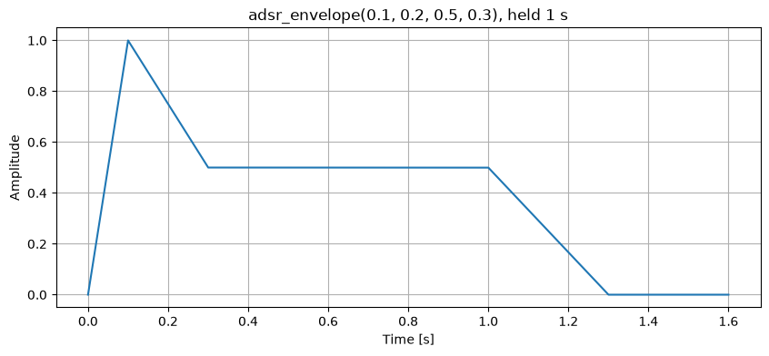
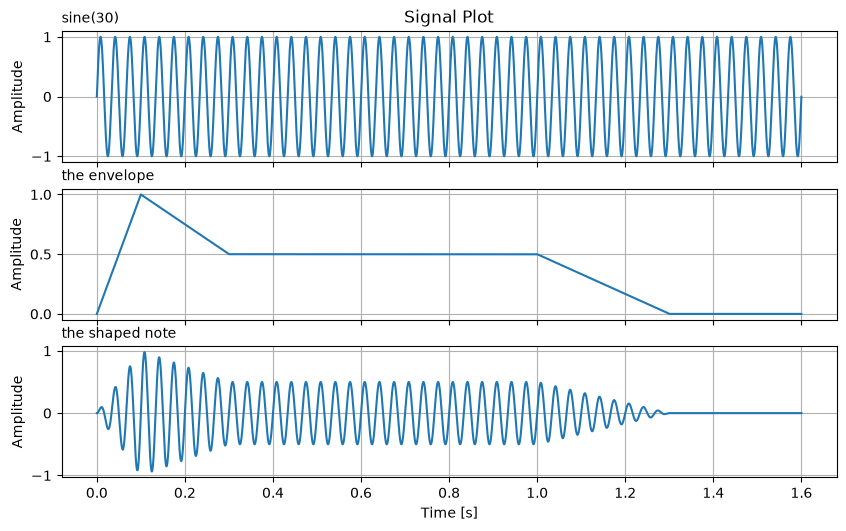
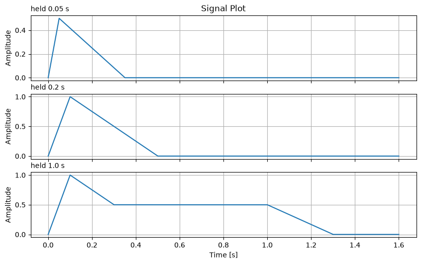

# Envelopes

<!-- md-toc: -->
- [How long is the note held?](#how-long-is-the-note-held)
- [Releasing early](#releasing-early)
- [Several notes with different lengths](#several-notes-with-different-lengths)
- [Percussive decays without ADSR](#percussive-decays-without-adsr)
<!-- md-toc: end -->

A raw oscillator is a constant drone. An envelope shapes its loudness over the
life of a note, from `symsound.envelope`:

```python
from symsound.envelope import ACTIVE_DURATION, adsr_envelope
from symsound.waves.utils import plot

env = adsr_envelope(attack=0.1, decay=0.2, sustain=0.5, release=0.3)
held = env.subs(ACTIVE_DURATION, 1.0)      # the note is held for one second
plot(held, duration=1.6, title="adsr_envelope(0.1, 0.2, 0.5, 0.3), held 1 s",
     output_file="img/envelopes-adsr.png")
```
<!-- md-code: id="envelopes-adsr"; bin="python3" -->



An ADSR envelope has four stages, all in seconds except sustain:

- **attack** (0 to 0.1 s): rises from 0 to 1.
- **decay** (0.1 to 0.3 s): falls from 1 to the sustain level.
- **sustain** (0.5 here): a level from 0 to 1, held while the note is held.
- **release** (1.0 to 1.3 s): falls from the current level to 0 once the note
  is released.

A duration of `0` skips that stage (an attack of 0 jumps straight to full volume).

## How long is the note held?

The envelope does not know how long you hold the note. That is the symbol
`ACTIVE_DURATION`, which you fill in with `subs` (above, 1.0 second). The note
sounds for the held time plus the release. The envelope is exactly zero before
time 0 and after the release has finished.

Multiply an oscillator by it to shape a note. The oscillator below is slow (30
Hz) so the shape can be seen:

```python
from symsound.envelope import ACTIVE_DURATION, adsr_envelope
from symsound.waves.basic import sine
from symsound.waves.utils import plot

env = adsr_envelope(0.1, 0.2, 0.5, 0.3).subs(ACTIVE_DURATION, 1.0)
plot([sine(30), env, sine(30) * env], duration=1.6,
     labels=["sine(30)", "the envelope", "the shaped note"], stacked=True,
     output_file="img/envelopes-note.png")
```
<!-- md-code: id="envelopes-note"; bin="python3" -->



## Releasing early

If the note is released early, in the middle of the attack or decay, the release
starts from whatever level the envelope had reached:

```python
from symsound.envelope import ACTIVE_DURATION, adsr_envelope
from symsound.waves.utils import plot

env = adsr_envelope(0.1, 0.2, 0.5, 0.3)
holds = [0.05, 0.2, 1.0]
plot([env.subs(ACTIVE_DURATION, h) for h in holds], duration=1.6,
     labels=[f"held {h} s" for h in holds], stacked=True,
     output_file="img/envelopes-early-release.png")
```
<!-- md-code: id="envelopes-early-release"; bin="python3" -->



Held 0.05 s is released halfway up the attack, and falls from there. Held 0.2 s
is released part-way down the decay.

## Several notes with different lengths

Build the envelope once and fill in a different `ACTIVE_DURATION` for each use:

```python
from symsound.envelope import ACTIVE_DURATION, adsr_envelope
from symsound.waves.basic import sine

env = adsr_envelope(0.01, 0.1, 0.5, 0.2)
short = sine(440) * env.subs(ACTIVE_DURATION, 0.25)
long = sine(550) * env.subs(ACTIVE_DURATION, 2.0)
```
<!-- md-code: id="envelopes-lengths"; bin="python3" -->

To place each note in a song, see [Time and rhythm](time-and-rhythm.md).

## Percussive decays without ADSR

Drum hits do not need ADSR. A repeating ramp raised to a power makes a decay
that restarts every cycle. See [Combining signals](combining.md) and
[the `house_with_low_pass.py` walkthrough](house-with-low-pass-walkthrough.md).
