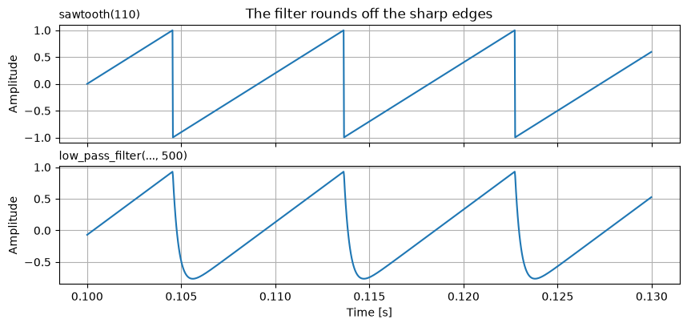
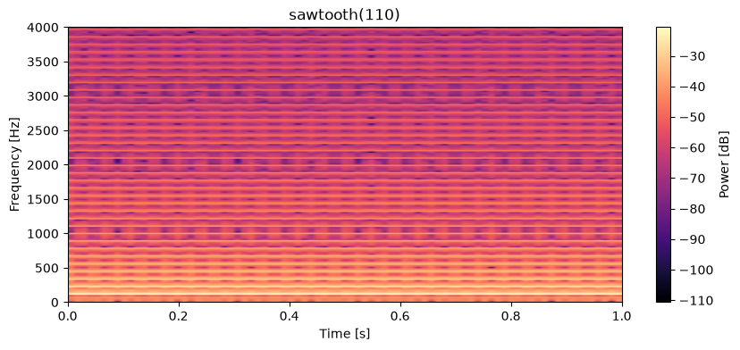
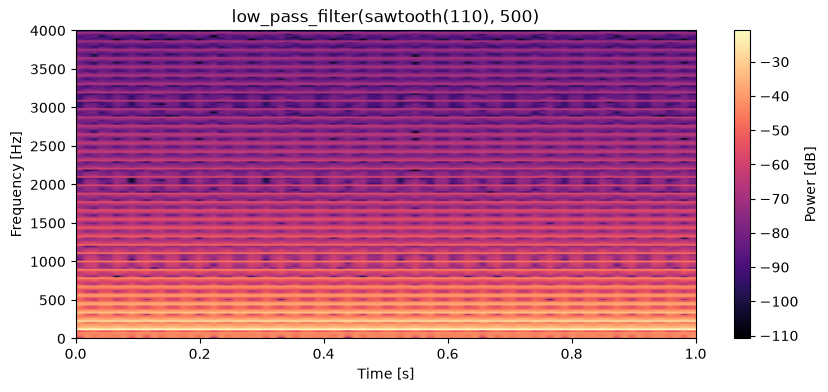
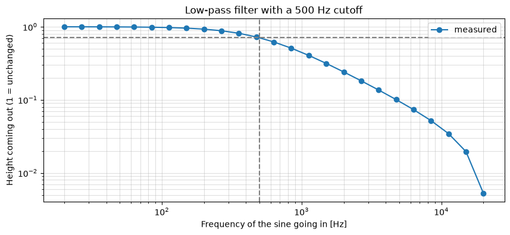
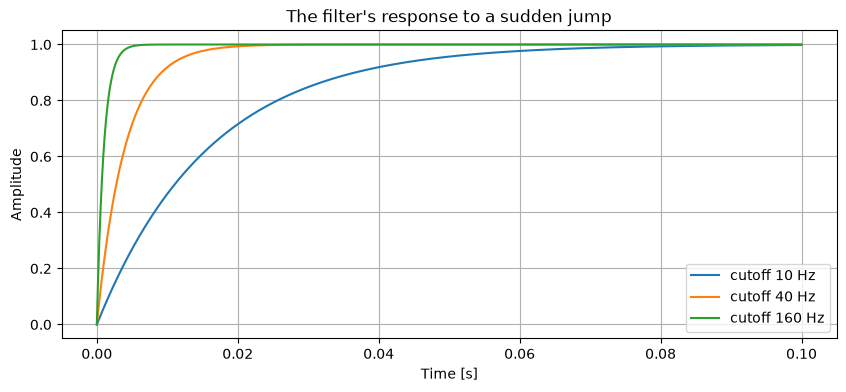
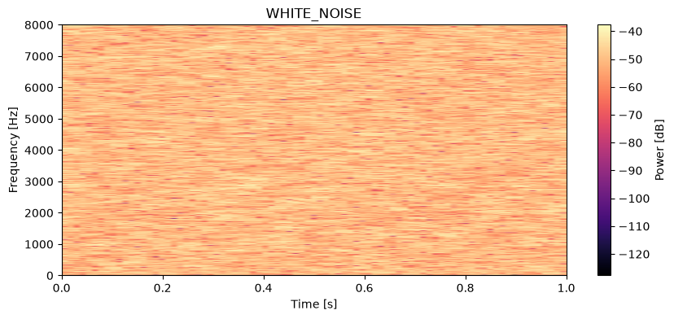
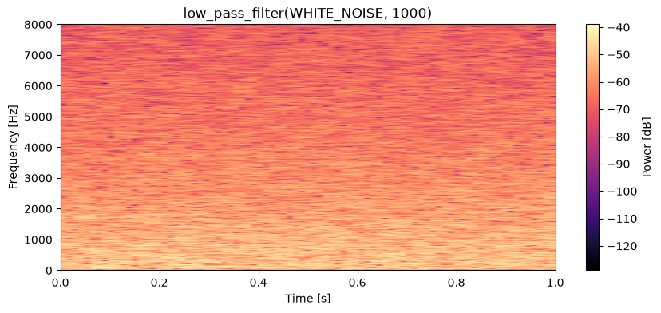
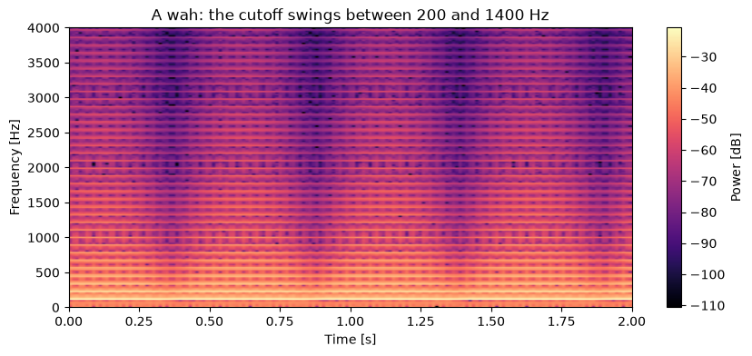

# Filters

<!-- md-toc: -->
- [What the cutoff means](#what-the-cutoff-means)
- [The time constant](#the-time-constant)
- [Filter anything](#filter-anything)
- [A cutoff that changes over time](#a-cutoff-that-changes-over-time)
- [How it behaves](#how-it-behaves)
- [Under the hood](#under-the-hood)
<!-- md-toc: end -->

`daw.filters.low_pass_filter(signal, cutoff)` removes the high-frequency part of
a sound and keeps the low part. The higher a frequency is above the cutoff, the
more it is turned down. It is the "muffled" sound: a hand over a speaker, music
heard through a wall.

```python
from daw.filters import low_pass_filter
from daw.waves.basic import sawtooth
from daw.waves.utils import plot

bright = sawtooth(110)
dull = low_pass_filter(bright, 500)    # keep what is below roughly 500 Hz
plot([bright, dull], duration=0.03, start=0.1,
     labels=["sawtooth(110)", "low_pass_filter(..., 500)"], stacked=True,
     title="The filter rounds off the sharp edges",
     output_file="img/filters-sawtooth.png")
```
<!-- md-code: id="filters-sawtooth"; bin="python3" -->



The sharp jumps of the sawtooth are high-frequency content, so the filter
smooths them. The result is an ordinary signal expression. Mix it, scale it,
shift it or filter it again like any other. (The plot uses `start=0.1` to skip
the first moments, when the filter is still starting up.)

The spectrogram shows what it does to the frequencies. Each line of the
sawtooth is a harmonic of 110 Hz. The filter leaves the low ones and fades the
high ones:

```python
from daw.filters import low_pass_filter
from daw.waves.basic import sawtooth
from daw.waves.utils import spectrogram

bright = sawtooth(110)
spectrogram(bright, duration=1.0, max_frequency=4000,
            title="sawtooth(110)", output_file="img/filters-spec-bright.png")
spectrogram(low_pass_filter(bright, 500), duration=1.0, max_frequency=4000,
            title="low_pass_filter(sawtooth(110), 500)",
            output_file="img/filters-spec-dull.png")
```
<!-- md-code: id="filters-spectrograms"; bin="python3" -->

| before | after |
| --- | --- |
|  |  |

## What the cutoff means

The cutoff is the frequency where the filter has turned the sound down to about
70% (-3 dB). It is a gentle, first-order filter. This graph measures it: a sine
at each frequency goes in, and the height of what comes out is plotted. The
dashed lines mark the cutoff (500 Hz) and 70%.

```python
import matplotlib.pyplot as plt
import numpy as np

from daw.filters import low_pass_filter
from daw.waves.basic import sine
from daw.waves.utils import compile

cutoff = 500
frequencies = np.geomspace(20, 20000, 25)
gains = []
for f in frequencies:
    out = compile(low_pass_filter(sine(f), cutoff), 0.3)
    tail = out[-int(44100 * max(0.05, 2 / f)):]      # a couple of cycles at the end
    gains.append(np.abs(tail).max())                  # their height

fig, ax = plt.subplots(figsize=(10, 4))
ax.loglog(frequencies, gains, "o-", label="measured")
ax.axvline(cutoff, color="gray", linestyle="--")
ax.axhline(1 / np.sqrt(2), color="gray", linestyle="--")
ax.set_xlabel("Frequency of the sine going in [Hz]")
ax.set_ylabel("Height coming out (1 = unchanged)")
ax.set_title("Low-pass filter with a 500 Hz cutoff")
ax.grid(True, which="both", alpha=0.4)
ax.legend()
fig.savefig("img/filters-response.png", dpi=100, bbox_inches="tight")
```
<!-- md-code: id="filters-response"; bin="python3" -->



| Frequency | Level after the filter |
| --- | --- |
| well below the cutoff | unchanged |
| at the cutoff | 0.71 of the original |
| 10x the cutoff | about 0.1 of the original |
| 100x the cutoff | about 0.01 |

That is -20 dB per decade, a gradual roll-off rather than a wall. Filtering
twice makes it steeper:

```python
from daw.filters import low_pass_filter
from daw.waves.basic import sawtooth

steeper = low_pass_filter(low_pass_filter(sawtooth(110), 500), 500)
```
<!-- md-code: id="filters-twice"; bin="python3" -->

A cutoff of `0` blocks everything. Cutoffs must not be negative.

## The time constant

Feed the filter a sudden jump (the constant 1, switched on at time zero) and the
output eases up towards it. The lower the cutoff, the slower it gets there:

```python
import sympy as sp

from daw.filters import low_pass_filter
from daw.waves.utils import plot

jump = sp.Integer(1)
cutoffs = [10, 40, 160]
plot([low_pass_filter(jump, c) for c in cutoffs], duration=0.1,
     labels=[f"cutoff {c} Hz" for c in cutoffs],
     title="The filter's response to a sudden jump",
     output_file="img/filters-step.png")
```
<!-- md-code: id="filters-step"; bin="python3" -->



The filter reaches 63% of the way in `1 / (2 * pi * cutoff)` seconds: 16 ms
for 10 Hz, 4 ms for 40 Hz and 1 ms for 160 Hz.

## Filter anything

The filter works on any signal: oscillators, noise, envelopes, sums, shifted
notes. Noise has every frequency in it equally, so the filter's effect is easy
to see:

```python
import numpy as np

from daw.filters import low_pass_filter
from daw.waves.utils import WHITE_NOISE, spectrogram

np.random.seed(0)
spectrogram(WHITE_NOISE, duration=1.0, max_frequency=8000, title="WHITE_NOISE",
            output_file="img/filters-noise.png")
spectrogram(low_pass_filter(WHITE_NOISE, 1000), duration=1.0, max_frequency=8000,
            title="low_pass_filter(WHITE_NOISE, 1000)",
            output_file="img/filters-noise-filtered.png")
```
<!-- md-code: id="filters-noise"; bin="python3" -->

| before | after |
| --- | --- |
|  |  |

Everything above about 1 kHz fades away and what is left is a low rumble.

## A cutoff that changes over time

The cutoff may itself be a signal, so the filter can sweep. The cutoff
expression must stay above zero:

```python
from daw.filters import low_pass_filter
from daw.waves.basic import sawtooth, sine
from daw.waves.utils import spectrogram

wah = low_pass_filter(sawtooth(110), 800 + 600 * sine(2))   # 200 to 1400 Hz, twice a second
spectrogram(wah, duration=2.0, max_frequency=4000,
            title="A wah: the cutoff swings between 200 and 1400 Hz",
            output_file="img/filters-wah.png")
```
<!-- md-code: id="filters-wah"; bin="python3" -->



For a smooth sweep that sounds even, move the cutoff exponentially, not
linearly, because we hear pitch as ratios. Moving from 12 kHz to 150 Hz is
`12000 * exp(-log(12000 / 150) * s)`, where `s` goes from 0 to 1. That is the
trick in the [`kick.py` walkthrough](kick-walkthrough.md).

## How it behaves

- The filter starts at rest at time zero. The first sample is silent and the
  output then follows the input.
- It adds a small delay (phase lag) that grows with frequency. You will not hear
  it on its own, but it matters if you mix filtered and unfiltered copies of the
  same sound. See [Combining signals](combining.md).
- A filtered expression can only be evaluated over a whole run of evenly spaced
  sample times, which is what `compile`, `play` and `save` do. It cannot be
  evaluated at a single time.

## Under the hood

`low_pass_filter` returns a `LowPass` expression, a placeholder that holds the
signal and the cutoff. When the expression is compiled, the signal and cutoff are
evaluated at every sample time and handed to `apply_low_pass(samples, cutoff,
sample_rate)`, which does the filtering on the sample array. You can call
`apply_low_pass` directly on a NumPy array if you already have samples; the
cutoff is one number or one value per sample.
