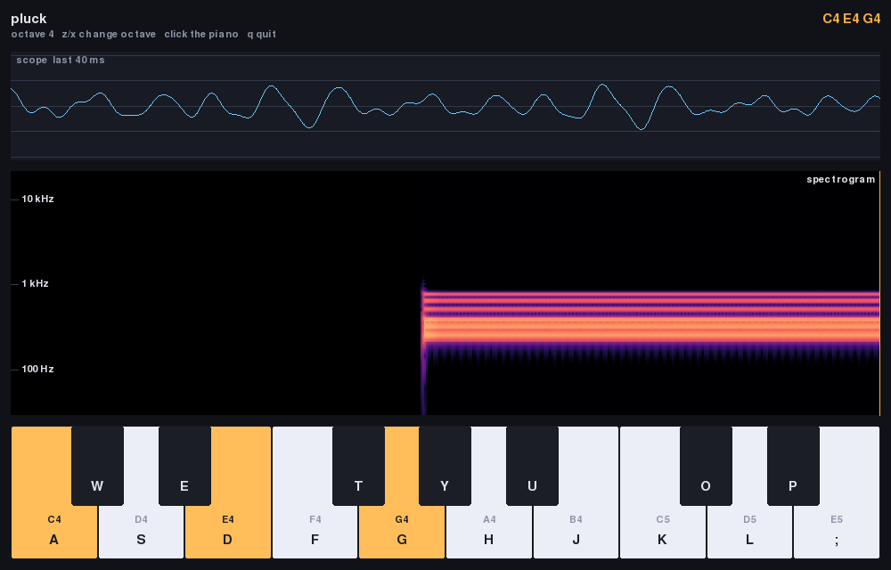

# A playable keyboard

<!-- md-toc: -->
- [Playing](#playing)
- [What you see](#what-you-see)
- [Options](#options)
- [Why an envelope is required](#why-an-envelope-is-required)
- [Which note is which key](#which-note-is-which-key)
- [The live spectrogram](#the-live-spectrogram)
<!-- md-toc: end -->

`keyboard` turns a signal into an instrument you play with the keys of your
computer. You give it a function from a `Note` to a signal, and it opens a window
with a piano, a scope and a spectrogram. It needs pygame (`pip install 'daw[gui]'`).

```python no-run
from daw.envelope import adsr_envelope
from daw.keyboard import keyboard
from daw.waves.basic import sine

def pluck(note):
    return (sine(note) + 0.3 * sine(2 * note)) * adsr_envelope(0.01, 0.1, 0.6, 0.4)

keyboard(pluck, title="pluck")      # opens a window you can play
```

The function takes a `Note` and returns an expression, exactly like the signals
everywhere else in the library; `sine(note)` works because a `Note` is its
frequency in Hz. Here is the window with a C major chord held down for three
seconds:

```python
from daw.constants import Note
from daw.envelope import adsr_envelope
from daw.keyboard import keyboard_snapshot
from daw.waves.basic import sine

def pluck(note):
    return (sine(note) + 0.3 * sine(2 * note)) * adsr_envelope(0.01, 0.1, 0.6, 0.4)

keyboard_snapshot(pluck, (Note.C4, Note.E4, Note.G4), "img/keyboard-chord.png",
                  title="pluck", seconds=3.0)
```
<!-- md-code: id="keyboard-chord"; bin="python3" -->



`examples/keyboard_synth.py` is a ready-made instrument to try: a glassy FM electric
piano with a sub, a drive stage and a tremolo, whose comments explain each layer.

## Playing

The keys follow the shape of a piano. The home row is the white keys and the row
above it the black keys, starting from the C of the current octave:

```
  W E   T Y U   O P
 A S D F G H J K L ;
 C D E F G A B C D E
```

| Input | What it does |
| --- | --- |
| `a s d f g h j k l ;` | The white keys: C D E F G A B, then C D E of the next octave |
| `w e t y u o p` | The black keys between them |
| `z`, `x` | Down and up an octave (1 to 7, starting at 4) |
| click or drag on the piano | Play the keys on screen; dragging slides from note to note |
| `q`, `esc` or closing the window | Quit |

Several keys at once make a chord, and the keys that are down light up on the piano
and are named at the top right. Letting go releases the note: an envelope's own
release plays out, and a signal with no envelope fades over 10 ms so it does not
click. Holding a key does not repeat the note, and keys that do nothing (the start
key, say) are ignored. If the window loses focus, every held note is released, so
nothing is left stuck on.

If you change octave while a key is held, that note keeps its pitch and is released
properly when you let go.

## What you see

The scope shows the last 40 ms of what is coming out of the speakers and the
spectrogram scrolls with the sound, with the newest column on the right (see
[Visualizing a signal](visualizing.md) for how to read them). Unlike `visualize`
there is no seek bar: the sound is live.

## Options

`keyboard(function, *, octave=4, gain=0.25, require_envelope=True, sample_rate=44100, title, silent, size)`

- `octave` is the starting octave, from 1 to 7.
- `gain` scales the sum of the notes, because notes add. The default of 0.25 keeps
  four full-scale notes under 1; ten fingers at once need less.
- `require_envelope` (on by default) refuses a signal that has no envelope. See
  below.
- `silent=True` shows everything but makes no sound.
- `size=(width, height)` sets the window size.

`keyboard_snapshot(function, held, output_file, *, octave, seconds, gain, require_envelope, sample_rate, title, size)`
saves a picture of the window after the notes in `held` have sounded for `seconds`.
It opens nothing and makes no sound; it is how the picture above was made.

Every note is compiled before the window opens, which takes a second or a few
depending on how elaborate the signal is, so
that pressing a key only does a little arithmetic (see [Live playback](live.md)).
A signal with a `low_pass_filter` in it cannot be played live and also raises a
`ValueError` before the window opens, because a filter needs the whole signal from
the start. A filter that sweeps in time, like the one in `house_with_low_pass.py`,
works in `visualize` instead.

## Why an envelope is required

A key goes down and, some time later, comes up. A signal only finds out about
that through `ACTIVE_DURATION`, the symbol inside `adsr_envelope`: the keyboard
holds it far in the future while the key is down, so the note sustains, and sets
it to the time you held the key when you let go, so the release plays out. A
signal with no envelope has nothing to tell, so it would sound until it was cut
off by a click.

So `keyboard` raises a `ValueError` for such a signal, naming the first note that
has none and saying what to do, before it opens anything:

```python no-run
keyboard(lambda note: sine(note))       # ValueError: the signal for A0 has no envelope ...
```

Multiply by `adsr_envelope(...)` to fix it. If you really want the bare signal, for
a quick test or a drone, pass `require_envelope=False` and it fades out over 10 ms
when the key comes up. The check covers every note of the keyboard, so one note
without an envelope is enough to be refused. `keyboard_snapshot` makes the same
check for the notes it holds.

## Which note is which key

`note_at(octave, semitone)` is the note a number of semitones above the C of an
octave (or `None` past the end of the table) and `note_name` writes a note the way
a musician does:

```python
from daw.keyboard import note_at, note_name

print(note_at(4, 0), "->", note_name(note_at(4, 0)))     # the home row's first key
print(note_at(4, 9), "->", note_name(note_at(4, 9)), note_at(4, 9).value, "Hz")
print(note_at(4, 1), "->", note_name(note_at(4, 1)))     # the first black key
print(note_at(7, 16))                                    # off the end of the table
```
<!-- md-code: id="keyboard-notes"; bin="python3" -->

Output:
```
Note.C4 -> C4
Note.A4 -> A4 440.0 Hz
Note.CS4 -> C#4
None

```
<!-- md-code-output: id="keyboard-notes" -->

## The live spectrogram

The spectrogram under the scope is a `LiveSpectrogram` from `daw.analysis`. It
looks at a `RingBuffer` that the speakers' callback fills, and each time you call
`update` it adds a column for every 512 samples that arrived since last time. The
result is exactly what `spectrogram_columns` gives for the same sound, however the
samples arrived:

```python
import numpy as np

from daw.analysis import LiveSpectrogram, spectrogram_columns
from daw.live import RingBuffer

rate = 8000
t = np.arange(rate) / rate
sound = np.sin(2 * np.pi * 440 * t)

ring = RingBuffer(16384)
live = LiveSpectrogram(rate, rows=64)
for start in range(0, rate, 700):          # arrives in uneven pieces
    ring.write(sound[start : start + 700])
    live.update(ring)

finished = spectrogram_columns(sound, rate, rows=64)
print("columns:", len(live.levels))
print("same as the finished spectrogram:",
      np.allclose(live.levels, finished[: len(live.levels)]))
```
<!-- md-code: id="keyboard-live"; bin="python3" -->

Output:
```
columns: 15
same as the finished spectrogram: True

```
<!-- md-code-output: id="keyboard-live" -->
