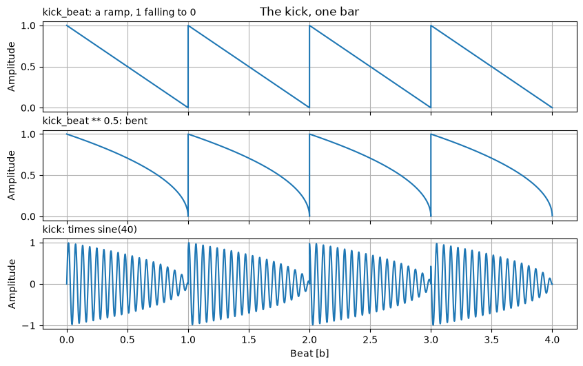
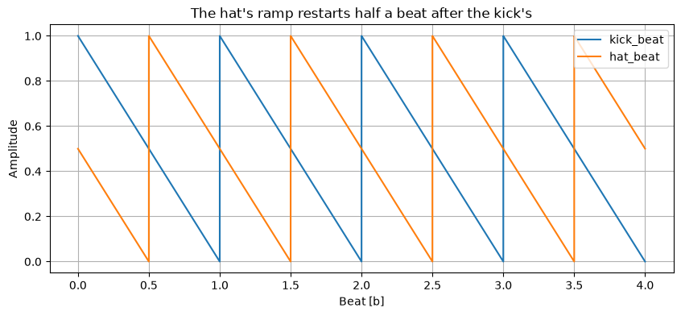
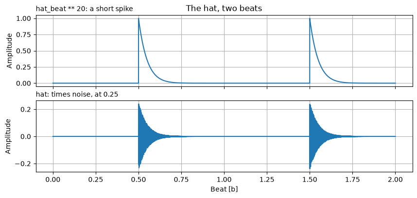
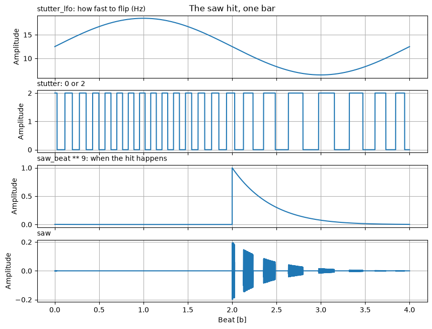
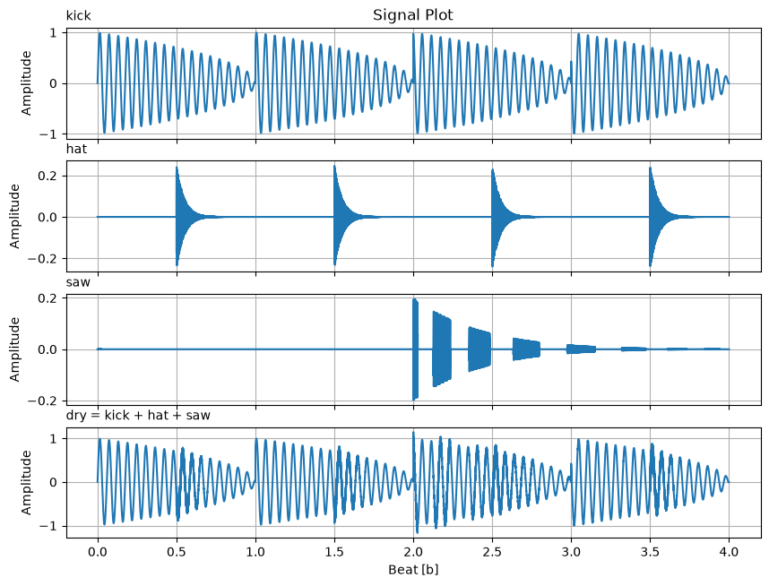
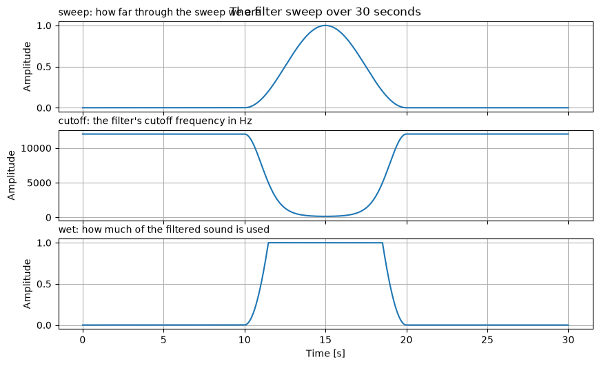
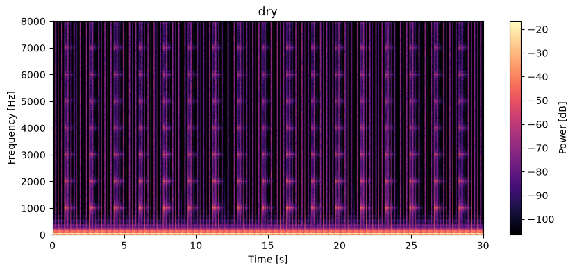
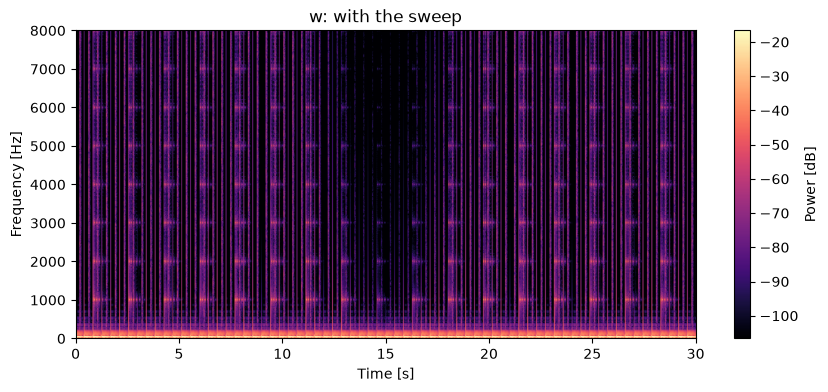
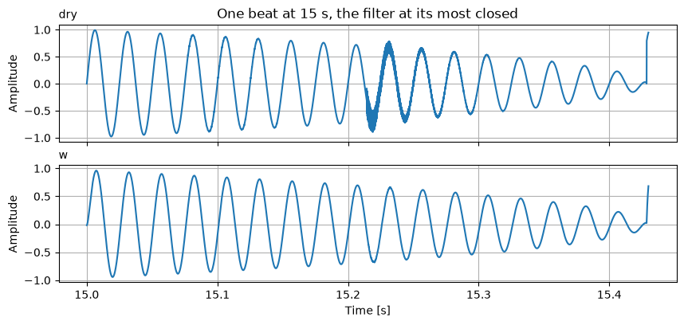

# Walkthrough: `examples/kick_with_low_pass.py`

<!-- md-toc: -->
- [The repeating decay (the trick behind every drum here)](#the-repeating-decay-the-trick-behind-every-drum-here)
- [The filter sweep](#the-filter-sweep)
- [The result](#the-result)
- [Changing it](#changing-it)
<!-- md-toc: end -->

`kick_with_low_pass.py` makes a 30 second beat: a kick drum, a hi-hat and a stuttering saw
buzz, with a low-pass filter sweep in the middle third. This page goes through
it a piece at a time. The code blocks are the real file, in order.

First, the imports and the tempo.

```python
import sympy as sp

from daw.filters import low_pass_filter
from daw.waves.basic import sawtooth, sine, square
from daw.waves.time import BPM, TIME
from daw.waves.utils import WHITE_NOISE, compile, play, plot, save

bpm = BPM(140)
```

`sp` is SymPy, needed for `Piecewise`, `sin`, `exp` and friends. `bpm` converts
beats to seconds: at 140 BPM one beat is 0.43 s. See [Time and
rhythm](time-and-rhythm.md).

## The repeating decay (the trick behind every drum here)

All three drums use the same idea, from [Combining signals](combining.md):
`(1 - sawtooth(f)) / 2` is a ramp that falls from 1 to 0 and restarts every
cycle, and raising it to a power bends it into a decay shape.

```python
kick_frequency = bpm.frequency(1)
kick_time_shift = TIME + bpm.time(0.5)
kick_beat = (1 - sawtooth(kick_frequency, time_shift=kick_time_shift)) / 2
kick_decay = .5

kick = (kick_beat**kick_decay) * sine(40)
```

- `bpm.frequency(1)` is one cycle per beat, so the ramp restarts every beat.
- `time_shift=TIME + bpm.time(0.5)` offsets the ramp by half a cycle so that
  it starts at its peak (1) exactly at time zero and falls to 0 by the end of
  the beat. Without the shift the ramp would start halfway down.
- `kick_beat ** 0.5` (a square root) keeps the level high for longer and then
  drops it at the end, a thumpy shape.
- `* sine(40)` is the body of the drum: a 40 Hz tone, loudest at the start of each
  beat and fading away before the next one.

So `kick` is a 40 Hz thump on every beat.

Here is the recipe over one bar (four beats), each step in its own panel. The
horizontal axis is in beats:

```python
import runpy

from daw.waves.utils import plot

ns = runpy.run_path("../examples/kick_with_low_pass.py")   # builds the signals, does not play
plot(
    [ns["kick_beat"], ns["kick_beat"] ** ns["kick_decay"], ns["kick"]],
    duration=4,
    bpm=ns["bpm"],
    labels=["kick_beat: a ramp, 1 falling to 0", "kick_beat ** 0.5: bent",
            "kick: times sine(40)"],
    stacked=True,
    title="The kick, one bar",
    output_file="img/kick-kick.png",
)
```
<!-- md-code: id="kick-kick"; bin="python3"; timeout=120 -->



The top panel is the ramp: it starts each beat at 1 and falls to 0. The middle
panel bends it. The bottom is the 40 Hz sine inside that outline: a thump at
the start of each beat that fades before the next.

```python
hat_frequency = bpm.frequency(1)
hat_time_shift = TIME + bpm.time(1)
hat_beat = (1 - sawtooth(hat_frequency, time_shift=hat_time_shift)) / 2
hat_decay = 20

hat = 0.25 * (hat_beat**hat_decay) * WHITE_NOISE
```

The hat is the same recipe with three differences:

- It is noise (`WHITE_NOISE`), not a tone, so it sounds like a hiss.
- The decay power is 20, so each hit is a very short tick.
- Its shift is a whole beat, which on its own would change nothing. But
  the kick shifts by half a beat, so the hat's peak lands *half a beat later*
  than the kick's: on the off-beat, between kicks.
- `0.25 *` keeps it quieter than the kick.

Plotting the kick's ramp and the hat's ramp together, in beats, shows the
offset:

```python
import runpy

from daw.waves.utils import plot

ns = runpy.run_path("../examples/kick_with_low_pass.py")
plot(
    [ns["kick_beat"], ns["hat_beat"]],
    duration=4,
    bpm=ns["bpm"],
    labels=["kick_beat", "hat_beat"],
    title="The hat's ramp restarts half a beat after the kick's",
    output_file="img/kick-offset.png",
)
```
<!-- md-code: id="kick-offset"; bin="python3"; timeout=120 -->



The kick ramp (blue) jumps back to 1 on the beat: 0, 1, 2, 3. The hat ramp
(orange) jumps back half a beat later: 0.5, 1.5, 2.5, 3.5. Then the power of
20 and the noise:

```python
import runpy

import numpy as np

from daw.waves.utils import plot

ns = runpy.run_path("../examples/kick_with_low_pass.py")
np.random.seed(0)    # the hat is noise: seed it so this graph is the same every run
plot(
    [ns["hat_beat"] ** ns["hat_decay"], ns["hat"]],
    duration=2,
    bpm=ns["bpm"],
    labels=["hat_beat ** 20: a short spike", "hat: times noise, at 0.25"],
    stacked=True,
    title="The hat, two beats",
    output_file="img/kick-hat.png",
)
```
<!-- md-code: id="kick-hat"; bin="python3"; timeout=120 -->



Raising to the power of 20 squashes the ramp into a narrow spike just after the
off-beat, and multiplying by noise fills the spike with hiss.

```python
saw_frequency = bpm.frequency(4)
saw_time_shift = TIME + bpm.time(4)
saw_beat = (1 - sawtooth(saw_frequency, time_shift=saw_time_shift)) / 2
saw_decay = 9

stutter_lfo = 6*sine(bpm.frequency(4)) + 12.5
stutter = square(stutter_lfo) + 1.0

saw = 0.1 * (saw_beat**saw_decay) * sawtooth(1000) * stutter
```

The saw hit is a buzzy 1000 Hz sawtooth that fires once per four-beat bar
(`bpm.frequency(4)`), at the middle of the bar, with a medium decay (power 9).

The `stutter` chops the buzz on and off like a gate:

- `stutter_lfo = 6*sine(bpm.frequency(4)) + 12.5` is a number that slowly
  moves between 6.5 and 18.5 over each bar.
- `square(stutter_lfo)` is a square wave whose *frequency is that number*, so it
  flips between +1 and -1 between about 6 and 18 times a second, getting faster
  and slower through the bar. This is frequency modulation: see
  [Oscillators](oscillators.md).
- `+ 1.0` turns the -1/+1 into 0/2: off or on (at double volume).

Multiplying the buzz by `stutter` gates it on and off at that varying rate.
`0.1 *` keeps it quiet.

```python
import runpy

from daw.waves.utils import plot

ns = runpy.run_path("../examples/kick_with_low_pass.py")
plot(
    [ns["stutter_lfo"], ns["stutter"], ns["saw_beat"] ** ns["saw_decay"], ns["saw"]],
    duration=4,
    bpm=ns["bpm"],
    labels=["stutter_lfo: how fast to flip (Hz)", "stutter: 0 or 2",
            "saw_beat ** 9: when the hit happens", "saw"],
    stacked=True,
    title="The saw hit, one bar",
    output_file="img/kick-saw.png",
)
```
<!-- md-code: id="kick-saw"; bin="python3"; timeout=120 -->



The first panel is the gate speed wandering between about 6 and 18 per second.
The second is the gate itself, flipping between 0 and 2. The third is the decay
outline, which peaks at the middle of the bar (beat 2). The last is the result:
the buzz, gated, inside that outline.

```python
dry = kick + hat + saw
```

`dry` is the whole beat with no effects: the three drums added together
("dry" is the audio term for unprocessed).

All three together, in one bar:

```python
import runpy

import numpy as np

from daw.waves.utils import plot

ns = runpy.run_path("../examples/kick_with_low_pass.py")
np.random.seed(0)    # the hat is noise: seed it so this graph is the same every run
plot(
    [ns["kick"], ns["hat"], ns["saw"], ns["dry"]],
    duration=4,
    bpm=ns["bpm"],
    labels=["kick", "hat", "saw", "dry = kick + hat + saw"],
    stacked=True,
    output_file="img/kick-dry.png",
)
```
<!-- md-code: id="kick-dry"; bin="python3"; timeout=120 -->



## The filter sweep

The goal: for the first 10 seconds play `dry` as is, for the next 10 seconds
sweep a low-pass filter down and back up, and for the last 10 seconds play
`dry` again, exactly as before.

```python
duration = 30
third = duration / 3
```

`third` is 10 seconds: the length of each section.

```python
sweep = sp.Piecewise(
    (
        sp.sin(sp.pi * (TIME - third) / third) ** 2,
        sp.And(TIME >= third, TIME <= 2 * third),
    ),
    (0.0, True),
)
```

`sweep` is a signal that says "how far through the sweep are we", from 0 to 1:

- Between 10 s and 20 s (`TIME >= third and TIME <= 2 * third`) it is
  `sin(pi * u) ** 2`, where `u = (TIME - third) / third` runs from 0 to 1 over
  those 10 seconds. That curve starts at 0, climbs smoothly to 1 at 15 s, and
  comes back to 0 at 20 s.
- Everywhere else (`(0.0, True)`: "otherwise") it is 0.

The graph below shows the whole 30 seconds. The top panel is `sweep`, the one
curve described here. The other two panels are built from it and explained next.

```python
import runpy

from daw.waves.utils import plot

ns = runpy.run_path("../examples/kick_with_low_pass.py")
plot(
    [ns["sweep"], ns["cutoff"], ns["wet"]],
    duration=30,
    labels=["sweep: how far through the sweep we are",
            "cutoff: the filter's cutoff frequency in Hz",
            "wet: how much of the filtered sound is used"],
    stacked=True,
    title="The filter sweep over 30 seconds",
    output_file="img/kick-sweep.png",
)
```
<!-- md-code: id="kick-sweep"; bin="python3"; timeout=120 -->



Everything else in the sweep is derived from this one curve.

```python
cutoff = 12000 * sp.exp(-sp.log(12000 / 150) * sweep)
```

`cutoff` is the filter's cutoff frequency in Hz, driven by `sweep`. This line is
the one that looks strangest, so step by step:

- When `sweep` is 0, `exp(-... * 0)` is 1 and the cutoff is `12000`: wide open,
  hardly any filtering.
- When `sweep` is 1, `exp(-log(12000 / 150))` is `150 / 12000`, so the cutoff
  is `12000 * 150 / 12000 = 150`: very closed, only bass gets through.
- In between it slides along a curve that is exponential, not a straight line.
  That is intentional: we hear frequencies as ratios (an octave is a doubling),
  so an even-sounding sweep multiplies by the same factor each moment instead of
  subtracting the same number of Hz.

| time | `sweep` | `cutoff` |
| --- | --- | --- |
| 0 to 10 s | 0 | 12000 Hz |
| 12.5 s | 0.5 | about 1340 Hz |
| 15 s | 1 | 150 Hz |
| 17.5 s | 0.5 | about 1340 Hz |
| 20 to 30 s | 0 | 12000 Hz |

The middle panel of the graph above is exactly this table: flat at 12000, then
curving down to 150 at 15 s and back up.

```python
wet = sp.Min(1.0, 5 * sweep)
```

`wet` is how much of the filtered sound to use: 0 means none, 1 means all of it.
`5 * sweep` rises five times as fast as `sweep`, and `Min(1.0, ...)` stops it at
1. So `wet` is 0 until the sweep starts, rises to 1 about a second and a half
into it, stays at 1, and falls back to 0 at the end.

Why not use the filter on its own? Even with the cutoff at 12 kHz, a filter
still changes the sound slightly. Blending it in from exactly 0 guarantees the first and last
thirds are the original sound with nothing left over.

```python
w = dry + wet * (low_pass_filter(dry, cutoff) - dry)
```

This is the crossfade from [Combining signals](combining.md):

- `low_pass_filter(dry, cutoff)` is the beat run through the filter, with the
  cutoff sweeping as described.
- `wet * (filtered - dry)` is the *difference* the filter makes, scaled by `wet`.
- Adding that to `dry` gives `dry` when `wet` is 0, the filtered sound when `wet`
  is 1, and a mix in between.

`w` is the finished piece.

## The result

Compare the dry beat with the finished piece. In the spectrograms, time runs
left to right, frequency goes up and brighter means louder. In the dry beat the
hat and saw spread energy up to the top of the picture. The sweep closes that
off, reaching the lowest point at 15 s, and then opens it again. The first and
last thirds are identical:

```python
import runpy

import numpy as np

from daw.waves.utils import spectrogram

ns = runpy.run_path("../examples/kick_with_low_pass.py")
np.random.seed(0)    # the hat is noise: seed it so this graph is the same every run
spectrogram(ns["dry"], 30, max_frequency=8000, title="dry",
            output_file="img/kick-spec-dry.png")
spectrogram(ns["w"], 30, max_frequency=8000, title="w: with the sweep",
            output_file="img/kick-spec-w.png")
```
<!-- md-code: id="kick-spectrograms"; bin="python3"; timeout=180 -->





The vertical stripes are the hits. The brightest band at the bottom is the kick
body, which the sweep never touches (40 Hz is far below the lowest cutoff of
150 Hz). Zooming in on one beat at the lowest point of the sweep, 15 s, shows the
hat and saw gone from the waveform while the kick remains:

```python
import runpy

import numpy as np

from daw.waves.utils import plot

ns = runpy.run_path("../examples/kick_with_low_pass.py")
np.random.seed(0)    # the hat is noise: seed it so this graph is the same every run
plot(
    [ns["dry"], ns["w"]],
    duration=0.43,
    start=15,
    labels=["dry", "w"],
    stacked=True,
    title="One beat at 15 s, the filter at its most closed",
    output_file="img/kick-zoom.png",
)
```
<!-- md-code: id="kick-zoom"; bin="python3"; timeout=180 -->



The top panel has the hat's burst of noise at the half-beat (around 15.22 s);
the bottom does not. What is left is the smooth kick wave. The saw only fires
at the middle of each bar, so it is not in this beat.

```python
# Only play and save when run as a script, so the signals above can be
# imported (the docs do this to draw graphs of them)
if __name__ == "__main__":
    play(w, duration)
    save(w, duration, "beat.wav")
```

When you run the file as a script, `play` sends it to the speakers and waits;
`save` writes `beat.wav`. Both compile the expression to 30 seconds of samples
first. When it is imported instead, nothing plays, which is how the graphs on
this page get the signals. See
[Playing, saving and plotting](output.md).

## Changing it

| To change | Edit |
| --- | --- |
| Tempo | `BPM(140)` |
| How hard the kick thumps | `kick_decay` (smaller is longer), the `40` in `sine(40)` for its pitch |
| How snappy the hat is | `hat_decay` (bigger is shorter) |
| Total length, and each third | `duration` |
| How closed the filter gets | the `150` in `cutoff` (lowest cutoff) |
| How open it starts | the two `12000`s in `cutoff` |
| How fast the filter fades in | the `5` in `wet` (bigger is quicker) |
| Make it a different effect | swap `low_pass_filter` for any signal you want to fade in |
