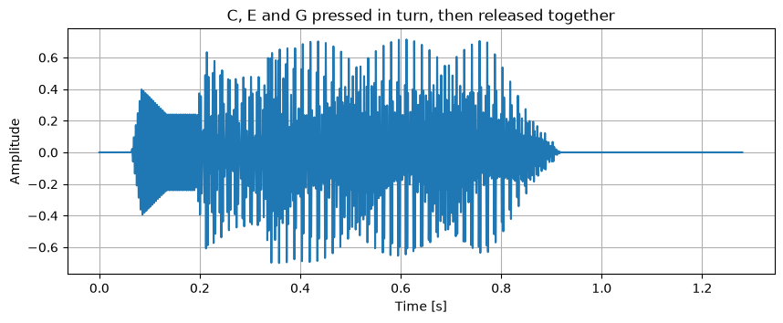

# Live playback

<!-- md-toc: -->
- [A note, rendered in pieces](#a-note-rendered-in-pieces)
- [Pressing and releasing keys](#pressing-and-releasing-keys)
- [One signal per note](#one-signal-per-note)
- [Playing through the speakers](#playing-through-the-speakers)
<!-- md-toc: end -->

`compile` builds a whole signal at once, which is right for `play`, `save` and
`plot`. A keyboard cannot wait for that: a note starts when a key goes down and
ends when it comes up, and the sound card wants a few hundred samples at a
time. `symsound.live` is the engine for that. It does the slow symbolic work once,
before any key is pressed, and after that makes sound with plain NumPy.

| Name | What it is |
| --- | --- |
| `NoteSource(expression, sample_rate)` | One signal, compiled to render any stretch of itself |
| `Instrument(function, sample_rate)` | A function from a `Note` to a signal, compiled once per note |
| `Mixer(gain)` | The notes that are sounding, summed a chunk at a time |
| `RingBuffer(capacity)` | The latest samples, for a display to draw |
| `LiveOutput(mixer, sample_rate, block_size, tap)` | Plays a `Mixer` through the speakers |

## A note, rendered in pieces

A `NoteSource` takes the expression for one note. Its `render(first, count)`
returns `count` samples starting at sample number `first`, counted from the moment
the note started. Any way of cutting the signal into pieces gives the same samples
as rendering it whole:

```python
import numpy as np

from symsound.envelope import adsr_envelope
from symsound.live import NoteSource
from symsound.waves.basic import sine
from symsound.waves.utils import compile

rate = 8000
note = sine(440) * adsr_envelope(0.02, 0.05, 0.6, 0.1)
source = NoteSource(note, rate)

pieces = [source.render(first, 512) for first in range(0, 2048, 512)]
whole = source.render(0, 2048)
print("pieces equal the whole:", np.allclose(np.concatenate(pieces), whole))
print("samples per piece:", len(pieces[0]))
```
<!-- md-code: id="live-pieces"; bin="python3" -->

Output:
```
pieces equal the whole: True
samples per piece: 512

```
<!-- md-code-output: id="live-pieces" -->

## Pressing and releasing keys

A `Mixer` holds the sounding notes. `note_on(key, source)` starts one and
`note_off(key)` releases it. The key is anything hashable that names the finger
on the keyboard, such as a `Note`. `render(count)` returns the next `count`
samples of the mix:

```python
import matplotlib.pyplot as plt
import numpy as np

from symsound.constants import Note
from symsound.envelope import adsr_envelope
from symsound.live import Instrument, Mixer
from symsound.waves.basic import sine

rate = 8000
voice = Instrument(lambda note: sine(note) * adsr_envelope(0.02, 0.05, 0.6, 0.15), rate)
voice.precompile([Note.C4, Note.E4, Note.G4])

mixer = Mixer(gain=0.4)
heard = []
chunk = 256                                  # the sound card asks for this many at a time
for step in range(40):
    if step == 2:
        mixer.note_on(Note.C4, voice.source(Note.C4))
    if step == 6:
        mixer.note_on(Note.E4, voice.source(Note.E4))
    if step == 10:
        mixer.note_on(Note.G4, voice.source(Note.G4))
    if step == 24:
        for note in (Note.C4, Note.E4, Note.G4):
            mixer.note_off(note)
    heard.append(mixer.render(chunk))
heard = np.concatenate(heard)

fig, ax = plt.subplots(figsize=(10, 3.5))
ax.plot(np.arange(len(heard)) / rate, heard)
ax.set(xlabel="Time [s]", ylabel="Amplitude", title="C, E and G pressed in turn, then released together")
ax.grid(True)
fig.savefig("img/live-chord.png", dpi=100, bbox_inches="tight")
print("notes still sounding at the end:", mixer.active)
print("peak:", round(float(np.abs(heard).max()), 2))
```
<!-- md-code: id="live-chord"; bin="python3" -->

Output:
```
notes still sounding at the end: 0
peak: 0.71

```
<!-- md-code-output: id="live-chord" -->



Things worth knowing:

- **A key that is already down is ignored.** Key auto-repeat cannot restart a note.
  A key that is still dying away can be pressed again; that starts a new note and
  lets the old one finish.
- **Release depends on the signal.** If the expression uses an envelope
  (`ACTIVE_DURATION`), the release is the envelope's own, measured from the moment
  of the key-up, and the note ends once it has fallen to exact silence. If it has
  no envelope, it fades out over 10 ms so it does not click.
- **Timing is per chunk.** A press or release takes effect at the start of the next
  chunk, so with 512-sample chunks at 44.1 kHz it is up to about 12 ms late.
- **`gain` matters.** Notes add. The default of 0.5 keeps two full-scale notes under
  1; use `1 / n` for `n` notes (above, three notes at a gain of 0.4 peak at 0.71).
- **No filters.** A `low_pass_filter` needs the whole signal from the start, so
  `NoteSource` raises a `ValueError` for a filtered expression.

## One signal per note

`Instrument(f)` takes a function of a `Note` that returns an expression. The first time a
note is asked for it is compiled and kept. Compiling is the slow part, a few
milliseconds per note, so compile before playing and not during it:

```python
import time

from symsound.constants import Note
from symsound.envelope import adsr_envelope
from symsound.live import Instrument
from symsound.waves.basic import sine

voice = Instrument(lambda note: sine(note) * adsr_envelope(0.01, 0.1, 0.7, 0.3))

start = time.perf_counter()
voice.precompile(list(Note))                 # every key of the piano
print("notes compiled:", len(list(Note)))
print("compiled in under a few seconds:", time.perf_counter() - start < 10)

start = time.perf_counter()
chunk = voice.source(Note.A4).render(0, 512)
print("one chunk renders in under 5 ms:", time.perf_counter() - start < 0.005)
```
<!-- md-code: id="live-instrument"; bin="python3" -->

Output:
```
notes compiled: 88
compiled in under a few seconds: True
one chunk renders in under 5 ms: True

```
<!-- md-code-output: id="live-instrument" -->

## Playing through the speakers

`LiveOutput` asks the `Mixer` for each block the sound card wants. Give it a
`RingBuffer` as `tap` and it also keeps the latest samples there, which is what a
scope or spectrogram reads. Use it as a context manager:

```python no-run
import time

from symsound.constants import Note
from symsound.envelope import adsr_envelope
from symsound.live import Instrument, LiveOutput, Mixer, RingBuffer
from symsound.waves.basic import sine

voice = Instrument(lambda note: sine(note) * adsr_envelope(0.01, 0.1, 0.7, 0.3))
voice.precompile([Note.A4])

mixer = Mixer()
scope = RingBuffer(44100)                    # one second of what was played
with LiveOutput(mixer, tap=scope):           # needs speakers
    mixer.note_on(Note.A4, voice.source(Note.A4))
    time.sleep(1.0)
    mixer.note_off(Note.A4)
    time.sleep(0.5)
print(scope.latest(512))
```

`RingBuffer.latest(n)` returns the newest `n` samples, oldest first, padded with
zeros in front if fewer have been written. `written` counts every sample ever
written, so a display can tell how much is new since it last looked.
