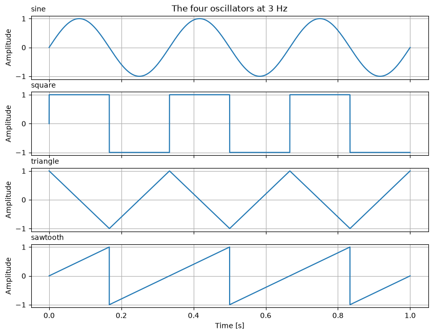
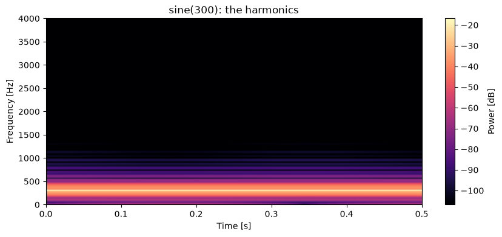
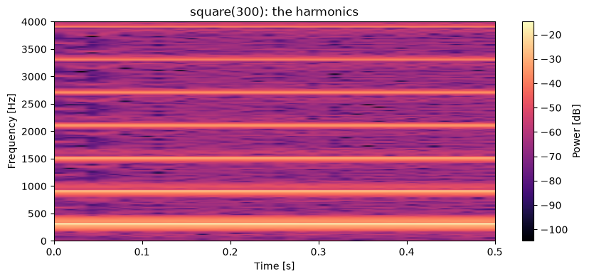
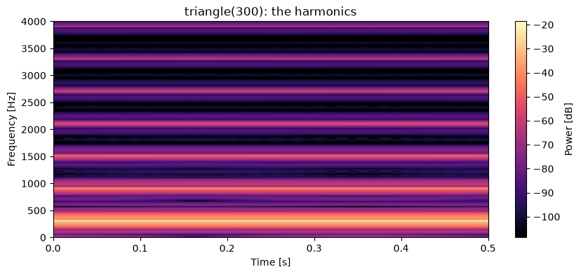
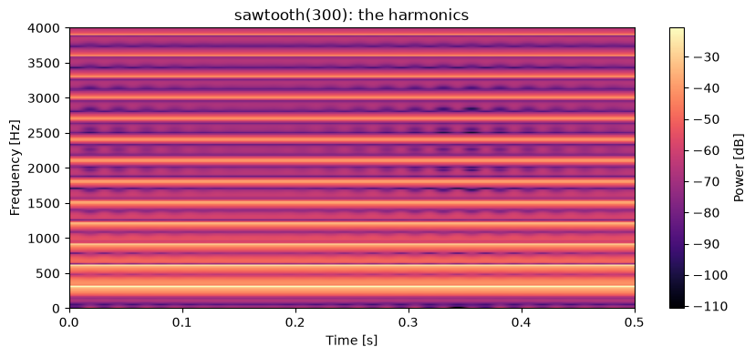
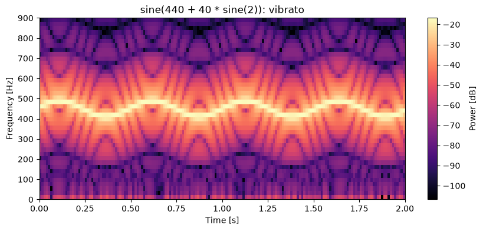
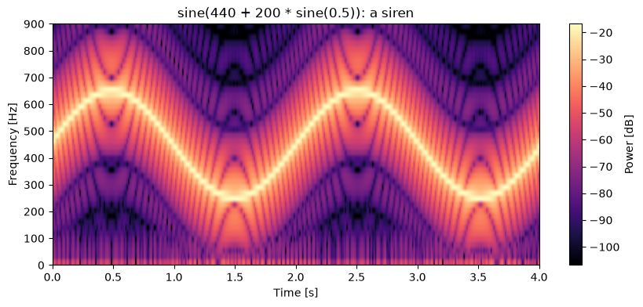
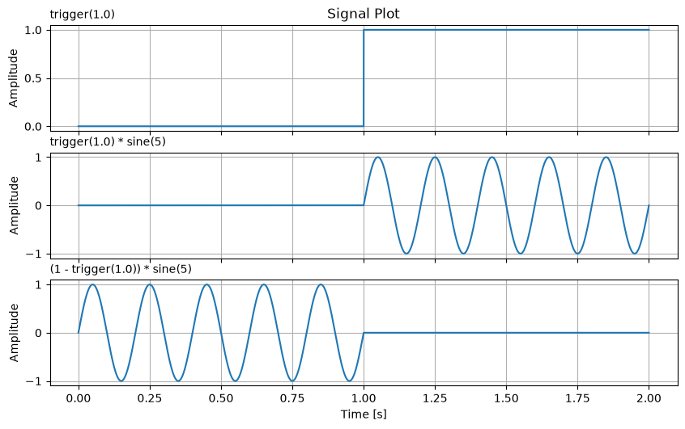

# Oscillators

<!-- md-toc: -->
- [Notes](#notes)
- [Frequency can be an expression](#frequency-can-be-an-expression)
- [Trigger](#trigger)
<!-- md-toc: end -->

An oscillator is a repeating wave. All of them live in `symsound.waves.basic` and
all take the same two arguments:

- `frequency`: how many cycles per second, as a number or an expression.
- `time_shift`: advanced use, see [Time and rhythm](time-and-rhythm.md).

Here are the four at 3 Hz (slow enough to see; at audio frequencies they look
the same, only faster):

```python
from symsound.waves.basic import sawtooth, sine, square, triangle
from symsound.waves.utils import plot

plot(
    [sine(3), square(3), triangle(3), sawtooth(3)],
    duration=1.0,
    labels=["sine", "square", "triangle", "sawtooth"],
    stacked=True,
    title="The four oscillators at 3 Hz",
    output_file="img/oscillators-four.png",
)
```
<!-- md-code: id="oscillators-four"; bin="python3" -->



| Function | Shape | Sound |
| --- | --- | --- |
| `sine` | smooth curve | pure, soft |
| `square` | jumps between +1 and -1 | hollow, buzzy |
| `triangle` | straight lines up and down | between sine and square |
| `sawtooth` | ramps up, jumps down | bright, harsh |

All four run between -1 and 1. The difference in sound is which harmonics
(multiples of the base frequency) they contain. A sine is only the base
frequency. The others add more, and the spectrogram makes that visible: each
bright line is a harmonic.

```python
from symsound.waves.basic import sawtooth, sine, square, triangle
from symsound.waves.utils import spectrogram

for name, wave in [("sine", sine), ("square", square),
                   ("triangle", triangle), ("sawtooth", sawtooth)]:
    spectrogram(wave(300), duration=0.5, max_frequency=4000,
                title=f"{name}(300): the harmonics",
                output_file=f"img/oscillators-harmonics-{name}.png")
```
<!-- md-code: id="oscillators-harmonics"; bin="python3" -->

| sine | square |
| --- | --- |
|  |  |
| **triangle** | **sawtooth** |
|  |  |

The sine has one line, at 300 Hz. The square has only the odd multiples (300,
900, 1500...). The triangle has those too but much quieter. The sawtooth has
all of them, which is why it sounds the brightest. `sawtooth_v2` is an additive
approximation that overshoots (see [Gotchas](gotchas.md)); prefer `sawtooth`.

## Notes

`symsound.constants.Note` is a table of equal-tempered pitches in Hz, from `A0`
(27.5 Hz) to `C8`. Sharps are written `AS4` (A sharp 4), `FS4` and so on.
Notes are plain floats, so you can do arithmetic with them:

```python
from symsound.constants import Note
from symsound.waves.basic import sine

print(Note.A4.value, Note.C4.value, Note.C5.value)   # in Hz
print(Note.C4 * 2)       # doubling the frequency is an octave up: about C5
middle_c = sine(Note.C4)
fifth_above = sine(Note.C4 * 1.5)    # about a perfect fifth up
```
<!-- md-code: id="oscillators-notes"; bin="python3" -->

Output:
```
440.0 261.63 523.25
523.26

```
<!-- md-code-output: id="oscillators-notes" -->

## Frequency can be an expression

Pass a signal as the frequency and the pitch changes over time. This is how
vibrato and frequency modulation (FM) work. A spectrogram shows the pitch
directly: time across, frequency up.

```python
from symsound.waves.basic import sine
from symsound.waves.utils import spectrogram

vibrato = sine(440 + 40 * sine(2))      # 440 Hz, wobbling +-40 Hz twice a second
spectrogram(vibrato, duration=2.0, max_frequency=900,
            title="sine(440 + 40 * sine(2)): vibrato",
            output_file="img/oscillators-vibrato.png")
```
<!-- md-code: id="oscillators-vibrato"; bin="python3" -->



```python
from symsound.waves.basic import sine
from symsound.waves.utils import spectrogram

siren = sine(440 + 200 * sine(0.5))     # slow sweep between 240 and 640 Hz
spectrogram(siren, duration=4.0, max_frequency=900,
            title="sine(440 + 200 * sine(0.5)): a siren",
            output_file="img/oscillators-siren.png")
```
<!-- md-code: id="oscillators-siren"; bin="python3" -->



The oscillator integrates the frequency to get the phase, so the pitch really
follows the expression. Keep the frequency positive.

## Trigger

`trigger(t)` is 0 before time `t` and 1 from `t` onward. It is a switch, useful
for starting or stopping things:

```python
from symsound.waves.basic import sine, trigger
from symsound.waves.utils import plot

starts_at_one_second = trigger(1.0) * sine(5)
stops_at_one_second = (1 - trigger(1.0)) * sine(5)
plot(
    [trigger(1.0), starts_at_one_second, stops_at_one_second],
    duration=2.0,
    labels=["trigger(1.0)", "trigger(1.0) * sine(5)", "(1 - trigger(1.0)) * sine(5)"],
    stacked=True,
    output_file="img/oscillators-trigger.png",
)
```
<!-- md-code: id="oscillators-trigger"; bin="python3" -->


