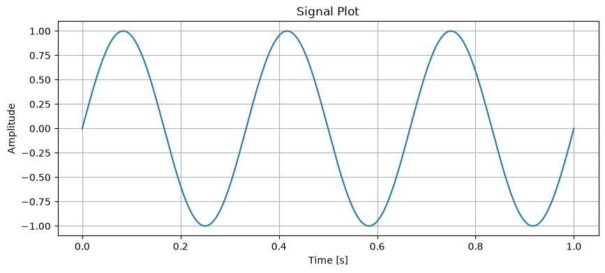
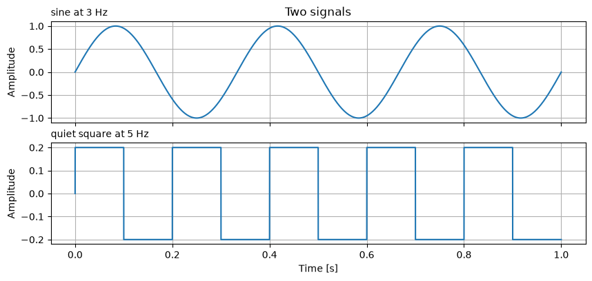
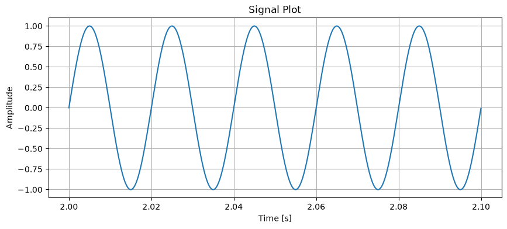
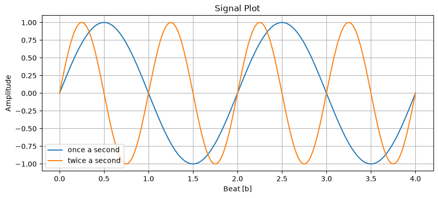
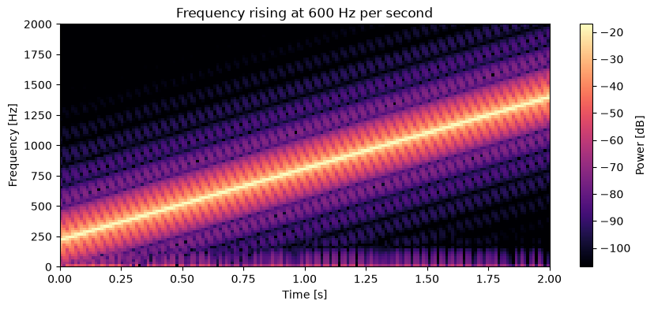
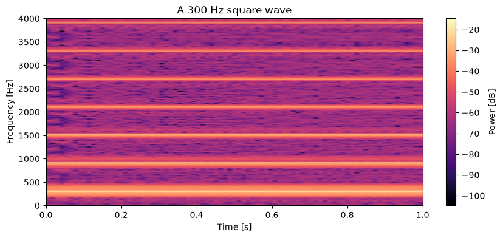

Playing, saving and plotting
============================

All in `daw.waves.utils`. Each takes a signal expression and a length.

<!-- md-toc: -->
- [Samples, WAV files and speakers](#samples-wav-files-and-speakers)
- [Plotting a signal](#plotting-a-signal)
  - [Several signals, stacked, with names](#several-signals-stacked-with-names)
  - [Looking at a window in the middle: `start`](#looking-at-a-window-in-the-middle-start)
  - [Plotting in beats](#plotting-in-beats)
- [Spectrograms: how the frequencies change](#spectrograms-how-the-frequencies-change)
- [Length matters](#length-matters)
- [Helpers](#helpers)
<!-- md-toc: end -->

## Samples, WAV files and speakers

```python
from daw.waves.basic import sine
from daw.waves.utils import compile, save

tone = sine(440)
samples = compile(tone, duration=0.5)
print(samples.shape, samples.min().round(3), samples.max().round(3))
save(tone, duration=1.0, output_file="tone.wav")      # a mono WAV file
```
<!-- md-code: id="output-compile"; bin="python3" -->

Output:
```
(22050,) -1.0 1.0

```
<!-- md-code-output: id="output-compile" -->

| Function | What it does |
| --- | --- |
| `compile(expr, duration, sample_rate=44100)` | Returns the samples as a NumPy array |
| `play(expr, duration=1.0, sample_rate=44100)` | Plays through the speakers and waits until it finishes |
| `save(expr, duration, output_file, sample_rate=44100)` | Writes a WAV file |
| `plot(expr_or_list, duration=1.0, bpm=None, ...)` | Draws the waveform |
| `spectrogram(expr, duration=1.0, ...)` | Draws how the frequencies change over time |

`duration` is in seconds. `play` needs a working audio device; the others do
not. Press Ctrl-C to stop `play` early.

```python no-run
from daw.waves.basic import sine
from daw.waves.utils import play

play(sine(440), 2.0)          # needs speakers
```

## Plotting a signal

`plot` draws the waveform. Pass `output_file` to write a PNG instead of opening
a window (this is how every graph in these docs is made).

```python
from daw.waves.basic import sine
from daw.waves.utils import plot

plot(sine(3), duration=1.0, output_file="img/output-plot.png")
```
<!-- md-code: id="output-plot"; bin="python3" -->



A sine at 3 Hz repeats three times in the one second shown. A 440 Hz tone would
be a solid block at this zoom, so for audible frequencies plot a few
milliseconds with a small `duration`.

### Several signals, stacked, with names

Pass a list to draw several signals. `labels` names them. `stacked=True` gives
each its own panel with its own vertical scale, which is easier to read when
the levels differ a lot.

```python
from daw.waves.basic import sine, square
from daw.waves.utils import plot

plot(
    [sine(3), 0.2 * square(5)],
    duration=1.0,
    labels=["sine at 3 Hz", "quiet square at 5 Hz"],
    stacked=True,
    title="Two signals",
    output_file="img/output-stacked.png",
)
```
<!-- md-code: id="output-stacked"; bin="python3" -->



Without `stacked`, they share one set of axes and `labels` makes a legend.

### Looking at a window in the middle: `start`

`start` begins the plot later than time zero. The signal is still computed from
the beginning, so things with memory (like [filters](filters.md)) are drawn
exactly as they would sound at that moment.

```python
from daw.waves.basic import sine
from daw.waves.utils import plot

plot(sine(50), duration=0.1, start=2.0, output_file="img/output-start.png")
```
<!-- md-code: id="output-start"; bin="python3" -->



### Plotting in beats

Pass a `BPM` and `duration` and `start` are read as beats, with a beats axis:

```python
from daw.waves.basic import sine
from daw.waves.time import BPM
from daw.waves.utils import plot

plot(
    [sine(1), sine(2)],
    duration=4,
    bpm=BPM(120),
    labels=["once a second", "twice a second"],
    output_file="img/output-beats.png",
)
```
<!-- md-code: id="output-beats"; bin="python3" -->



Four beats at 120 BPM is two seconds, so the 1 Hz sine completes two cycles.

## Spectrograms: how the frequencies change

A waveform shows loudness over time but not which frequencies are in the sound.
`spectrogram` shows that: time runs left to right, frequency goes up, and the
colour is how loud that frequency is (brighter is louder, over a 90 dB range).

A rising sweep from 200 Hz makes a diagonal line:

```python
from daw.waves.basic import sine
from daw.waves.time import TIME
from daw.waves.utils import spectrogram

spectrogram(
    sine(200 + 600 * TIME),
    duration=2.0,
    max_frequency=2000,
    title="Frequency rising at 600 Hz per second",
    output_file="img/output-spectrogram.png",
)
```
<!-- md-code: id="output-spectrogram"; bin="python3" -->



`max_frequency` limits the vertical axis (the default is half the sample rate).
A square wave has odd harmonics: lines at 1x, 3x, 5x... the base frequency.

```python
from daw.waves.basic import square
from daw.waves.utils import spectrogram

spectrogram(
    square(300),
    duration=1.0,
    max_frequency=4000,
    title="A 300 Hz square wave",
    output_file="img/output-spectrogram-square.png",
)
```
<!-- md-code: id="output-spectrogram-square"; bin="python3" -->



You will see lines at 300, 900, 1500 Hz and so on, getting fainter. That is the
buzzy character of a square wave.

`spectrogram` takes the same `start` and `output_file`, in seconds. It needs a
window of about a twentieth of a second at least (2048 samples).

## Length matters

Your expression is evaluated from time zero for exactly `duration` seconds. Make
the duration at least as long as the sounds you want to hear, including their
release tails. A song's length is the end of its last note plus that note's
release.

## Helpers

`daw.waves.utils.linspace(duration, sample_rate)` makes the array of sample times
that `compile` uses, and `white_noise(duration, sample_rate)` makes the noise
samples that replace `WHITE_NOISE`. You rarely need them directly.
