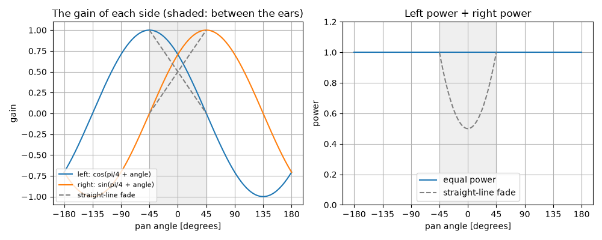
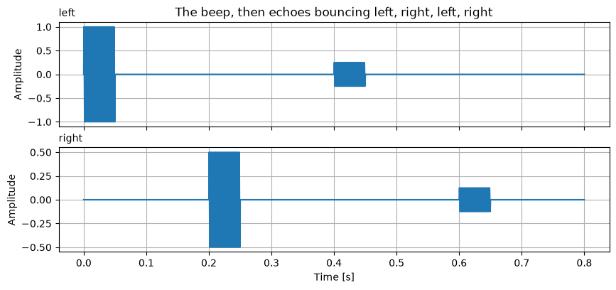
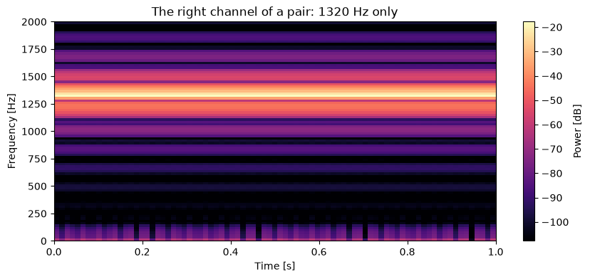

# StereoExpr

<!-- md-toc: -->
- [Two signals, one for each ear](#two-signals-one-for-each-ear)
- [Placing a sound: `pan`](#placing-a-sound-pan)
  - [Why equal power](#why-equal-power)
  - [A position that moves](#a-position-that-moves)
- [Effects on both sides: `map`](#effects-on-both-sides-map)
- [Looking at a stereo signal](#looking-at-a-stereo-signal)
- [An example to run](#an-example-to-run)
- [The limits](#the-limits)
<!-- md-toc: end -->

Until now a signal has been one expression, heard the same in both ears. A
stereo signal is two of them: `StereoExpr(left, right)`, from `daw.stereo`. Each
side is an ordinary expression of `TIME`, so everything in the other pages
(mixing, envelopes, filters, `delay`) works on a side, and nothing about mono
changes. A bare expression is still mono.

## Two signals, one for each ear

```python
from daw.stereo import StereoExpr
from daw.waves.basic import sine
from daw.waves.utils import compile, plot

pair = StereoExpr(sine(440), sine(660))
samples = compile(pair, duration=0.5)
print(samples.shape)
plot(pair, duration=0.01, stacked=True,
     title="A different pitch in each ear",
     output_file="img/stereo-pair.png")
```
<!-- md-code: id="stereo-pair"; bin="python3" -->

Output:
```
(22050, 2)

```
<!-- md-code-output: id="stereo-pair" -->


`compile` gives an array with one row per sample and two columns, left first.
A mono signal still compiles to one dimension. `save` writes a two-channel WAV
file and `play` plays it in stereo, with the same calls as before.

A side can be a number too (`StereoExpr(sine(440), 0)` is silent on the right).

`mono_to_stereo(signal)` is a mono signal heard equally in both ears. That is what a
mono signal already sounds like on speakers, but as a `StereoExpr` it can be
combined with other sides.

When a signal uses `WHITE_NOISE`, both sides get the same noise samples, so
`mono_to_stereo(noise)` is exactly the same in both ears. Noise that differs between
the ears has to be built from two separate sources, which this library does
not have yet.

## Placing a sound: `pan`

```python
from daw.effects import pan
from daw.waves.basic import sine
from daw.waves.utils import plot

left_ish = pan(sine(440), -0.5)
plot(left_ish, duration=0.01, stacked=True,
     title="pan(sine(440), -0.5): louder on the left",
     output_file="img/stereo-pan.png")
print(left_ish.left, "|", left_ish.right)
```
<!-- md-code: id="stereo-pan"; bin="python3" -->

Output:
```
sqrt(sqrt(2)/4 + 1/2)*sin(880*pi*time) | sqrt(1/2 - sqrt(2)/4)*sin(880*pi*time)

```
<!-- md-code-output: id="stereo-pan" -->


`pan(signal, position)` puts a mono signal between the ears. `-1` is all left,
`0` is the centre and `1` is all right.

### Why equal power

The obvious way to pan is to fade one side down while the other comes up in a
straight line. At the centre each side is then half as loud, and the two halves
add up to less sound than either end: the sound sinks in the middle. What the ear
judges as loudness follows power, which is the square of the gain, so the
gains should keep `left**2 + right**2` the same everywhere. `pan` does that with
a quarter turn: the left gain is `cos(angle)` and the right is `sin(angle)`,
where the angle goes from 0 (all left) to 90 degrees (all right) as the position
goes from -1 to 1. Since `cos**2 + sin**2 = 1`, the power never changes.

```python
import matplotlib.pyplot as plt
import numpy as np

position = np.linspace(-1, 1, 400)
angle = (position + 1) * np.pi / 4
left, right = np.cos(angle), np.sin(angle)
linear_left, linear_right = (1 - position) / 2, (1 + position) / 2

fig, (gains, power) = plt.subplots(1, 2, figsize=(10, 4), sharex=True)
gains.plot(position, left, label="left: cos(angle)")
gains.plot(position, right, label="right: sin(angle)")
gains.plot(position, linear_left, "--", color="grey", label="straight-line fade")
gains.plot(position, linear_right, "--", color="grey")
gains.axvline(0, color="black", lw=0.5)
gains.set_title("The gain of each side")
gains.set_xlabel("pan position")
gains.set_ylabel("gain")
gains.legend()
gains.grid(True)

power.plot(position, left**2 + right**2, label="equal power")
power.plot(position, linear_left**2 + linear_right**2, "--", color="grey",
           label="straight-line fade")
power.set_ylim(0, 1.2)
power.set_title("Left power + right power")
power.set_xlabel("pan position")
power.set_ylabel("power")
power.legend(loc="lower center")
power.grid(True)
fig.tight_layout()
fig.savefig("img/stereo-equal-power.png", dpi=100)
print(round(float(np.cos(np.pi / 4)), 4), "at the centre, per side")
print(round(20 * np.log10(np.cos(np.pi / 4)), 2), "dB at the centre, per side")
print(round(float(linear_left[200] ** 2 + linear_right[200] ** 2), 2),
      "total power at the centre of a straight-line fade")
```
<!-- md-code: id="stereo-equal-power"; bin="python3" -->

Output:
```
0.7071 at the centre, per side
-3.01 dB at the centre, per side
0.5 total power at the centre of a straight-line fade

```
<!-- md-code-output: id="stereo-equal-power" -->



The left graph shows the gains: the solid curves are what `pan` uses, the
dashed lines are the straight-line fade. The right graph shows the power each
one delivers. The equal-power law stays flat at 1. The straight-line fade drops to
a half at the centre, which is the dip you hear. The price of staying level is
that a centred signal is about 3 dB quieter in each ear than the same signal hard
left or right: each side is `1/sqrt(2)` of it, and the two together make up
the same power as one hard-panned side.

### A position that moves

The position can also be an expression of `TIME`, so a sound can travel. Pass a
slow sine for an auto-pan, or a ramp for a sweep. A moving position is held
between -1 and 1, so a wave that overshoots stops at the edge instead of
turning the sound out of phase.

```python
import numpy as np
import matplotlib.pyplot as plt

from daw.effects import pan
from daw.waves.basic import sine
from daw.waves.utils import compile

# A constant 1 makes the two sides the gains themselves
gains = compile(pan(1, sine(1)), duration=2.0)
t = np.arange(len(gains)) / 44100

fig, (top, bottom) = plt.subplots(2, 1, figsize=(10, 5), sharex=True)
top.plot(t, np.sin(2 * np.pi * t), color="grey")
top.set_title("The position: sine(1), one sweep across the ears each second")
top.set_ylabel("position")
top.grid(True)
bottom.plot(t, gains[:, 0], label="left gain")
bottom.plot(t, gains[:, 1], label="right gain")
bottom.plot(t, gains[:, 0] ** 2 + gains[:, 1] ** 2, "--", color="grey",
            label="total power")
bottom.set_xlabel("Time [s]")
bottom.set_ylabel("gain")
bottom.legend(loc="center right")
bottom.grid(True)
fig.tight_layout()
fig.savefig("img/stereo-auto-pan.png", dpi=100)
print(gains.shape, round(float((gains**2).sum(axis=1).std()), 6))
```
<!-- md-code: id="stereo-auto-pan"; bin="python3" -->

Output:
```
(88200, 2) 0.0

```
<!-- md-code-output: id="stereo-auto-pan" -->


The last line prints the spread of `left**2 + right**2` over the whole
sweep: zero, so the loudness stays level as the sound moves. A fixed position
is a plain number from -1 to 1, and anything outside that range is an error.
A moving position may only depend on `TIME`.

## Effects on both sides: `map`

`StereoExpr.map(function)` applies one function to the left and to the right.

```python
import sympy as sp

from daw.effects import delay
from daw.stereo import StereoExpr
from daw.waves.basic import sine
from daw.waves.time import TIME
from daw.waves.utils import plot

beep = sine(500) * sp.Piecewise((1, (TIME >= 0) & (TIME < 0.05)), (0, True))
dry = StereoExpr(beep, 0)
wet = dry.map(lambda side: side + 0.5 * delay(side, 0.2))
plot(wet, duration=0.5, stacked=True,
     title="map(lambda side: side + 0.5 * delay(side, 0.2))",
     output_file="img/stereo-map.png")
```
<!-- md-code: id="stereo-map"; bin="python3" -->


Each side is processed on its own, so a filter on the left does not know about
the right, and each starts at rest. To make the two sides different, build them
separately, for example a ping-pong echo whose repeats alternate between the
ears:

```python
import sympy as sp

from daw.effects import delay
from daw.stereo import StereoExpr
from daw.waves.basic import sine
from daw.waves.time import TIME
from daw.waves.utils import plot

beep = sine(500) * sp.Piecewise((1, (TIME >= 0) & (TIME < 0.05)), (0, True))
left = beep + 0.25 * delay(beep, 0.4)
right = 0.5 * delay(beep, 0.2) + 0.125 * delay(beep, 0.6)
ping_pong = StereoExpr(left, right)
plot(ping_pong, duration=0.8, stacked=True,
     title="The beep, then echoes bouncing left, right, left, right",
     output_file="img/stereo-ping-pong.png")
```
<!-- md-code: id="stereo-ping-pong"; bin="python3" -->



## Looking at a stereo signal

`plot` takes a `StereoExpr` like any other signal and draws two lines, named
`left` and `right`. With `stacked=True` each side gets its own panel, as in the
graphs above. Give it a label and the sides become `"<label> (left)"` and
`"<label> (right)"`. In a list, a stereo signal counts as one signal for
`labels` but draws two lines.

`spectrogram` shows one channel at a time, because a spectrogram is a single
picture. `channel` is `"left"`, `"right"`, or `"mix"` (the default), the average
of the two. It applies only to a stereo signal.

```python
from daw.stereo import StereoExpr
from daw.waves.basic import sine
from daw.waves.utils import spectrogram

pair = StereoExpr(sine(440), sine(1320))
spectrogram(pair, duration=1.0, channel="right", max_frequency=2000,
            title="The right channel of a pair: 1320 Hz only",
            output_file="img/stereo-spectrogram.png")
```
<!-- md-code: id="stereo-spectrogram"; bin="python3" -->



## An example to run

`examples/stereo_pan.py` plays three short versions in turn: three plucked notes
placed hard left, centre and hard right with `pan`, an echo that bounces from ear
to ear, and a held chord whose position follows `sine(0.5)` so it sweeps across
and back. Use headphones.

```sh
python examples/stereo_pan.py
```

## The limits

- `visualize` and `keyboard` do not take a `StereoExpr` yet.
- A `StereoExpr` is a pair, not an expression: it cannot be added to a mono signal
  or multiplied. Apply the arithmetic to each side, or use `map`.
