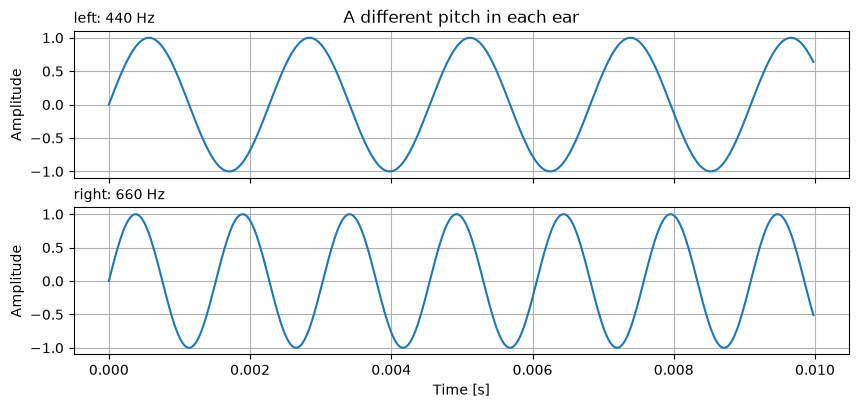
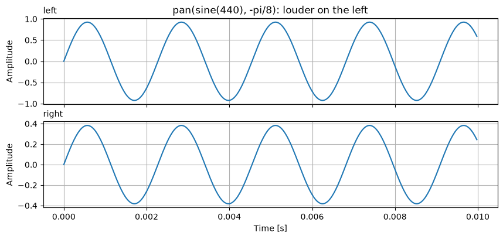
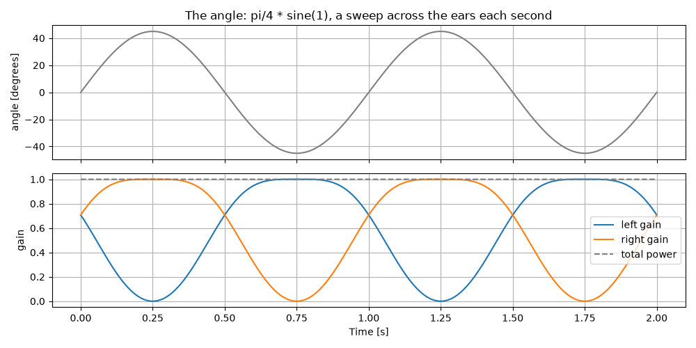
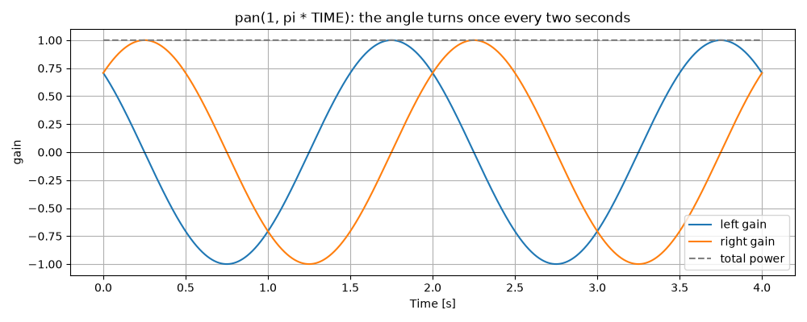
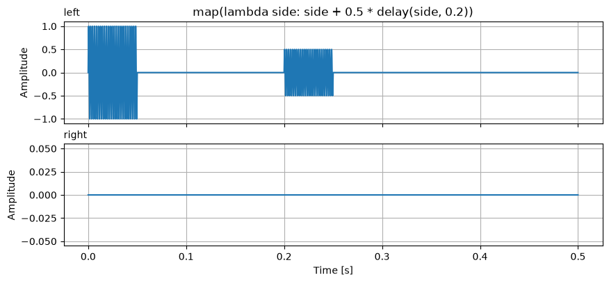

# StereoExpr

<!-- md-toc: -->
- [Two signals, one for each ear](#two-signals-one-for-each-ear)
- [Placing a sound: `pan`](#placing-a-sound-pan)
  - [Why equal power](#why-equal-power)
  - [An angle that moves](#an-angle-that-moves)
  - [An angle with no limit](#an-angle-with-no-limit)
- [Effects on both sides: `map`](#effects-on-both-sides-map)
- [Looking at a stereo signal](#looking-at-a-stereo-signal)
- [Examples to run](#examples-to-run)
- [The limits](#the-limits)
<!-- md-toc: end -->

Until now a signal has been one expression, heard the same in both ears. A
stereo signal is two of them: `StereoExpr(left, right)`, from `symsound.stereo`. Each
side is an ordinary expression of `TIME`, so everything in the other pages
(mixing, envelopes, filters, `delay`) works on a side, and nothing about mono
changes. A bare expression is still mono.

## Two signals, one for each ear

```python
from symsound.stereo import StereoExpr
from symsound.waves.basic import sine
from symsound.waves.utils import compile, plot

pair = StereoExpr(sine(440), sine(660))
samples = compile(pair, duration=0.5)
print(samples.shape)
plot(pair, duration=0.01, stacked=True,
     title="A different pitch in each ear",
     output_file="img/stereo-pair.png")
```
<!-- md-code: id="stereo-pair"; bin="python3" -->

Output:
```
(22050, 2)

```
<!-- md-code-output: id="stereo-pair" -->



`compile` gives an array with one row per sample and two columns, left first.
A mono signal still compiles to one dimension. `save` writes a two-channel WAV
file and `play` plays it in stereo, with the same calls as before.

A side can be a number too (`StereoExpr(sine(440), 0)` is silent on the right).

`mono_to_stereo(signal)` is a mono signal heard equally in both ears. That is what a
mono signal already sounds like on speakers, but as a `StereoExpr` it can be
combined with other sides.

When a signal uses `WHITE_NOISE`, both sides get the same noise samples, so
`mono_to_stereo(noise)` is exactly the same in both ears. Noise that differs between
the ears has to be built from two separate sources, which this library does
not have yet.

## Placing a sound: `pan`

```python
import sympy as sp

from symsound.effects import pan
from symsound.waves.basic import sine
from symsound.waves.utils import plot

left_ish = pan(sine(440), -sp.pi / 8)
plot(left_ish, duration=0.01, stacked=True,
     title="pan(sine(440), -pi/8): louder on the left",
     output_file="img/stereo-pan.png")
print(left_ish.left, "|", left_ish.right)
```
<!-- md-code: id="stereo-pan"; bin="python3" -->

Output:
```
sqrt(sqrt(2)/4 + 1/2)*sin(880*pi*time) | sqrt(1/2 - sqrt(2)/4)*sin(880*pi*time)

```
<!-- md-code-output: id="stereo-pan" -->



`pan(signal, angle)` puts a mono signal between the ears. The angle is in
radians, measured from the centre: `0` is the middle, `pi/4` (45 degrees) is all
right and `-pi/4` is all left. Write degrees with `sp.rad(45)`. Writing `pi` as
`sp.pi`, as above, keeps the gains exact, so the far ear at the edge is exactly
silent; a float such as `np.pi / 4` leaves a trace of rounding error there.

At angle `0` the sound is the same in both ears: it sounds centred, like mono,
but each ear gets `1/sqrt(2)` of the signal (3 dB less), not all of it.
`mono_to_stereo(x)` gives each ear the whole signal, so `pan(x, 0)` is
`mono_to_stereo(x) / sqrt(2)`. The reason is below.

### Why equal power

The obvious way to pan is to fade one side down while the other comes up in a
straight line. At the centre each side is then half as loud, and the two halves
add up to less sound than either end: the sound sinks in the middle. What the ear
judges as loudness follows power, which is the square of the gain, so the gains
should keep `left**2 + right**2` the same everywhere. `pan` does that with a
quarter turn: the left gain is `cos(pi/4 + angle)` and the right is
`sin(pi/4 + angle)`. Since `cos**2 + sin**2 = 1`, the power never changes.

```python
import matplotlib.pyplot as plt
import numpy as np

degrees = np.linspace(-180, 180, 721)
angle = np.radians(degrees)
left, right = np.cos(np.pi / 4 + angle), np.sin(np.pi / 4 + angle)

# A straight-line fade, for comparison, only exists between the ears
between = np.abs(degrees) <= 45
spread = degrees[between] / 45
linear_left, linear_right = (1 - spread) / 2, (1 + spread) / 2

fig, (gains, power) = plt.subplots(1, 2, figsize=(10, 4), sharex=True)
for axes in (gains, power):
    axes.axvspan(-45, 45, color="grey", alpha=0.12)
    axes.set_xlabel("pan angle [degrees]")
    axes.set_xticks(range(-180, 181, 45))
    axes.grid(True)
gains.plot(degrees, left, label="left: cos(pi/4 + angle)")
gains.plot(degrees, right, label="right: sin(pi/4 + angle)")
gains.plot(degrees[between], linear_left, "--", color="grey",
           label="straight-line fade")
gains.plot(degrees[between], linear_right, "--", color="grey")
gains.set_title("The gain of each side (shaded: between the ears)")
gains.set_ylabel("gain")
gains.legend(loc="lower left", fontsize=8)

power.plot(degrees, left**2 + right**2, label="equal power")
power.plot(degrees[between], linear_left**2 + linear_right**2, "--", color="grey",
           label="straight-line fade")
power.set_ylim(0, 1.2)
power.set_title("Left power + right power")
power.set_ylabel("power")
power.legend(loc="lower center")
fig.tight_layout()
fig.savefig("img/stereo-equal-power.png", dpi=100)
print(round(float(np.cos(np.pi / 4)), 4), "at the centre, per side")
print(round(20 * np.log10(np.cos(np.pi / 4)), 2), "dB at the centre, per side")
print(round(float(linear_left[len(linear_left) // 2] ** 2
                  + linear_right[len(linear_right) // 2] ** 2), 2),
      "total power at the centre of a straight-line fade")
```
<!-- md-code: id="stereo-equal-power"; bin="python3" -->

Output:
```
0.7071 at the centre, per side
-3.01 dB at the centre, per side
0.5 total power at the centre of a straight-line fade

```
<!-- md-code-output: id="stereo-equal-power" -->


The left graph shows the gains: the solid curves are what `pan` uses, the
dashed lines are the straight-line fade, and the shaded band is the range
between the ears, from -45 to 45 degrees. The right graph shows the power each
one delivers. The equal-power law stays flat at 1. The straight-line fade drops to
a half at the centre, which is the dip you hear. The price of staying level is
that a centred signal is about 3 dB quieter in each ear than the same signal hard
left or right: each side is `1/sqrt(2)` of it, and the two together make up
the same power as one hard-panned side.

### An angle that moves

The angle can also be an expression of `TIME`, so a sound can travel. Pass a
slow sine for an auto-pan: a sine scaled to `pi/4` swings the sound from hard
left to hard right and back.

```python
import numpy as np
import matplotlib.pyplot as plt
import sympy as sp

from symsound.effects import pan
from symsound.waves.basic import sine
from symsound.waves.utils import compile

# A constant 1 makes the two sides the gains themselves
gains = compile(pan(1, sp.pi / 4 * sine(1)), duration=2.0)
t = np.arange(len(gains)) / 44100

fig, (top, bottom) = plt.subplots(2, 1, figsize=(10, 5), sharex=True)
top.plot(t, 45 * np.sin(2 * np.pi * t), color="grey")
top.set_title("The angle: pi/4 * sine(1), a sweep across the ears each second")
top.set_ylabel("angle [degrees]")
top.grid(True)
bottom.plot(t, gains[:, 0], label="left gain")
bottom.plot(t, gains[:, 1], label="right gain")
bottom.plot(t, gains[:, 0] ** 2 + gains[:, 1] ** 2, "--", color="grey",
            label="total power")
bottom.set_xlabel("Time [s]")
bottom.set_ylabel("gain")
bottom.legend(loc="center right")
bottom.grid(True)
fig.tight_layout()
fig.savefig("img/stereo-auto-pan.png", dpi=100)
print(gains.shape, round(float((gains**2).sum(axis=1).std()), 6))
```
<!-- md-code: id="stereo-auto-pan"; bin="python3" -->

Output:
```
(88200, 2) 0.0

```
<!-- md-code-output: id="stereo-auto-pan" -->



The last line prints the spread of `left**2 + right**2` over the whole
sweep: zero, so the loudness stays level as the sound moves. An angle may only
depend on `TIME`.

### An angle with no limit

The angle is not clamped. The gains repeat every whole turn (`2*pi`), so any
number is fine, and an angle that keeps growing turns the sound round and round.
Past the edge at `pi/4` it carries on: one ear's gain goes through zero and
becomes negative, a copy of the signal upside down (anti-phase), and the other
follows half a turn later. Power stays level the whole way.

```python
import numpy as np
import matplotlib.pyplot as plt
import sympy as sp

from symsound.effects import pan
from symsound.waves.time import TIME
from symsound.waves.utils import compile

# One whole turn every two seconds, for four seconds
gains = compile(pan(1, sp.pi * TIME), duration=4.0)
t = np.arange(len(gains)) / 44100

fig, ax = plt.subplots(figsize=(10, 4))
ax.plot(t, gains[:, 0], label="left gain")
ax.plot(t, gains[:, 1], label="right gain")
ax.plot(t, gains[:, 0] ** 2 + gains[:, 1] ** 2, "--", color="grey",
        label="total power")
ax.axhline(0, color="black", lw=0.5)
ax.set_title("pan(1, pi * TIME): the angle turns once every two seconds")
ax.set_xlabel("Time [s]")
ax.set_ylabel("gain")
ax.legend(loc="lower right")
ax.grid(True)
fig.tight_layout()
fig.savefig("img/stereo-spin.png", dpi=100)
print(round(float(gains[:, 0].min()), 3), round(float(gains[:, 0].max()), 3))
```
<!-- md-code: id="stereo-spin"; bin="python3" -->

Output:
```
-1.0 1.0

```
<!-- md-code-output: id="stereo-spin" -->



The left gain goes from 1 down to -1 and back each turn, which is the sound
passing through anti-phase on the far side. For a sound that stays between the
ears, keep the angle within `pi/4` of the centre.

## Effects on both sides: `map`

`StereoExpr.map(function)` applies one function to the left and to the right.

```python
import sympy as sp

from symsound.effects import delay
from symsound.stereo import StereoExpr
from symsound.waves.basic import sine
from symsound.waves.time import TIME
from symsound.waves.utils import plot

beep = sine(500) * sp.Piecewise((1, (TIME >= 0) & (TIME < 0.05)), (0, True))
dry = StereoExpr(beep, 0)
wet = dry.map(lambda side: side + 0.5 * delay(side, 0.2))
plot(wet, duration=0.5, stacked=True,
     title="map(lambda side: side + 0.5 * delay(side, 0.2))",
     output_file="img/stereo-map.png")
```
<!-- md-code: id="stereo-map"; bin="python3" -->



Each side is processed on its own, so a filter on the left does not know about
the right, and each starts at rest. To make the two sides different, build them
separately, for example a ping-pong echo whose repeats alternate between the
ears:

```python
import sympy as sp

from symsound.effects import delay
from symsound.stereo import StereoExpr
from symsound.waves.basic import sine
from symsound.waves.time import TIME
from symsound.waves.utils import plot

beep = sine(500) * sp.Piecewise((1, (TIME >= 0) & (TIME < 0.05)), (0, True))
left = beep + 0.25 * delay(beep, 0.4)
right = 0.5 * delay(beep, 0.2) + 0.125 * delay(beep, 0.6)
ping_pong = StereoExpr(left, right)
plot(ping_pong, duration=0.8, stacked=True,
     title="The beep, then echoes bouncing left, right, left, right",
     output_file="img/stereo-ping-pong.png")
```
<!-- md-code: id="stereo-ping-pong"; bin="python3" -->


## Looking at a stereo signal

`plot` takes a `StereoExpr` like any other signal and draws two lines, named
`left` and `right`. With `stacked=True` each side gets its own panel, as in the
graphs above. Give it a label and the sides become `"<label> (left)"` and
`"<label> (right)"`. In a list, a stereo signal counts as one signal for
`labels` but draws two lines.

`spectrogram` shows one channel at a time, because a spectrogram is a single
picture. `channel` is `"left"`, `"right"`, or `"mix"` (the default), the average
of the two. It applies only to a stereo signal.

```python
from symsound.stereo import StereoExpr
from symsound.waves.basic import sine
from symsound.waves.utils import spectrogram

pair = StereoExpr(sine(440), sine(1320))
spectrogram(pair, duration=1.0, channel="right", max_frequency=2000,
            title="The right channel of a pair: 1320 Hz only",
            output_file="img/stereo-spectrogram.png")
```
<!-- md-code: id="stereo-spectrogram"; bin="python3" -->


## Examples to run

Three short examples, each playing one thing. Use headphones.

```sh
python examples/stereo_placed.py       # three plucks: left, centre, right
python examples/stereo_ping_pong.py    # an echo that bounces between the ears
python examples/stereo_sweep.py        # a chord that sweeps from ear to ear
```

- `examples/stereo_placed.py` puts three plucked notes at hard left (`-pi/4`),
  the centre (`0`) and hard right (`pi/4`) with `pan`.
- `examples/stereo_ping_pong.py` builds a `StereoExpr` by hand, from `delay`
  terms, so the echoes alternate between the ears.
- `examples/stereo_sweep.py` pans a held chord with an angle that is itself an
  expression of `TIME`, a slow sine, so it swings across and back.

## The limits

- `visualize` and `keyboard` do not take a `StereoExpr` yet.
- A `StereoExpr` is a pair, not an expression: it cannot be added to a mono signal
  or multiplied. Apply the arithmetic to each side, or use `map`.
