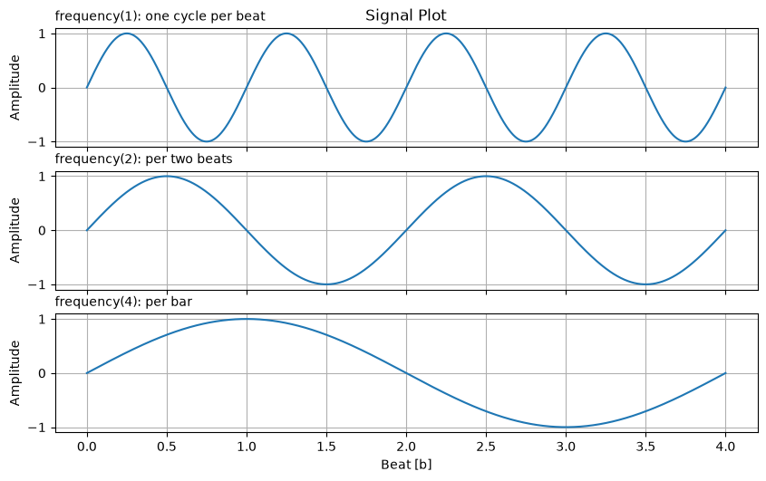
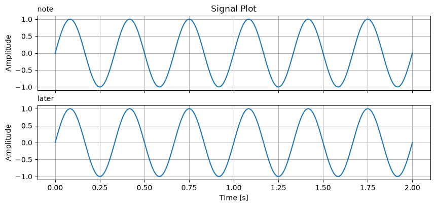
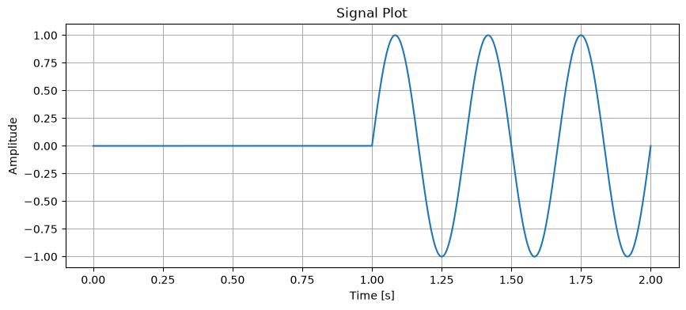
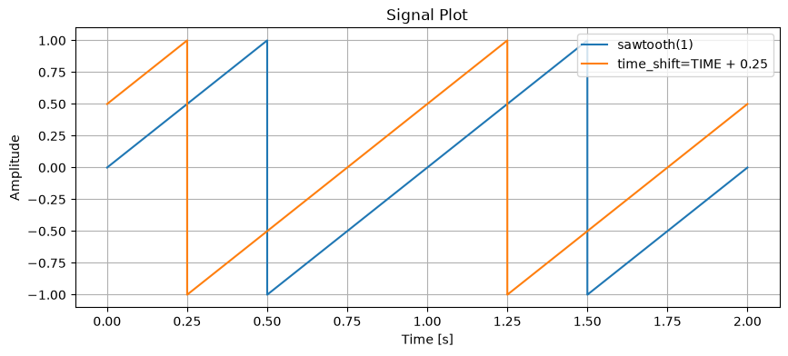
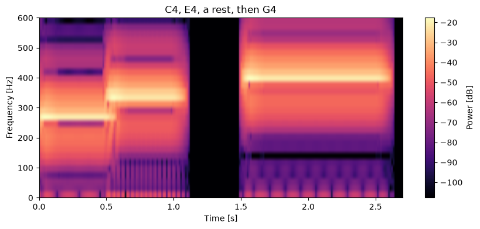

# Time and rhythm

<!-- md-toc: -->
- [BPM](#bpm)
- [Two ways to shift a signal in time](#two-ways-to-shift-a-signal-in-time)
  - [1. Shifting the whole expression: `subs(TIME, TIME - delay)`](#1-shifting-the-whole-expression-substime-time-delay)
  - [2. The `time_shift` argument on oscillators](#2-the-time_shift-argument-on-oscillators)
- [Placing notes in a song](#placing-notes-in-a-song)
<!-- md-toc: end -->

## BPM

`BPM` converts between beats and seconds so you can write music in beats:

```python
from daw.waves.time import BPM

bpm = BPM(140)
print(bpm.time(1))        # seconds in one beat
print(bpm.time(4))        # seconds in a bar of four beats
print(bpm.frequency(1))   # a signal that repeats once per beat
print(bpm.frequency(4))   # repeats once per four beats
print(bpm.beat(bpm.time(1)))   # which beat it is at that many seconds
```
<!-- md-code: id="time-bpm"; bin="python3" -->

Output:
```
0.42857142857142855
1.7142857142857142
2.3333333333333335
0.5833333333333334
1.0

```
<!-- md-code-output: id="time-bpm" -->

`bpm.frequency(n)` is the one to remember. A wave with that frequency completes
one cycle every `n` beats, which locks it to the tempo. `sine(bpm.frequency(1))`
is an LFO that goes round once per beat. Plots can use beats on the axis too:

```python
from daw.waves.basic import sine
from daw.waves.time import BPM
from daw.waves.utils import plot

bpm = BPM(140)
plot(
    [sine(bpm.frequency(1)), sine(bpm.frequency(2)), sine(bpm.frequency(4))],
    duration=4, bpm=bpm,
    labels=["frequency(1): one cycle per beat", "frequency(2): per two beats",
            "frequency(4): per bar"],
    stacked=True,
    output_file="img/time-bpm-frequency.png",
)
```
<!-- md-code: id="time-bpm-frequency"; bin="python3" -->



## Two ways to shift a signal in time

### 1. Shifting the whole expression: `subs(TIME, TIME - delay)`

To start a signal `delay` seconds later, replace `TIME` with `TIME - delay`:

```python
from daw.waves.basic import sine
from daw.waves.time import TIME
from daw.waves.utils import plot

note = sine(3)
later = note.subs(TIME, TIME - 1.0)    # the same note, one second later
plot([note, later], duration=2.0, labels=["note", "later"], stacked=True,
     output_file="img/time-subs.png")
```
<!-- md-code: id="time-subs"; bin="python3" -->



This is how songs are built: each note is made once, then shifted to where it
belongs. `examples/ode_to_joy.py` does exactly this for every note.

Careful: look at the second panel. The delayed sine is still sounding during the
first second (it is a sine at negative time). Delaying just moves the waveform;
it does not silence the part before. To start it silent, multiply by `trigger`:

```python
from daw.waves.basic import sine, trigger
from daw.waves.time import TIME
from daw.waves.utils import plot

starts_silent = sine(3).subs(TIME, TIME - 1.0) * trigger(1.0)
plot(starts_silent, duration=2.0, output_file="img/time-subs-silent.png")
```
<!-- md-code: id="time-subs-silent"; bin="python3" -->



[ADSR envelopes](envelopes.md) are silent before time 0 by design, so a note
with an envelope can be shifted freely.

### 2. The `time_shift` argument on oscillators

Each oscillator takes `time_shift`, an expression to use in place of `TIME`
inside that one oscillator. `TIME + x` starts the oscillator `x` seconds *into*
its cycle, which is the opposite direction from `subs`:

```python
from daw.waves.basic import sawtooth
from daw.waves.time import TIME
from daw.waves.utils import plot

normal = sawtooth(1)
ahead = sawtooth(1, time_shift=TIME + 0.25)   # starts a quarter cycle in
plot([normal, ahead], duration=2.0,
     labels=["sawtooth(1)", "time_shift=TIME + 0.25"],
     output_file="img/time-time-shift.png")
```
<!-- md-code: id="time-time-shift"; bin="python3" -->



The shifted wave is the same shape, but its jumps arrive a quarter of a cycle
sooner. Use it to offset the phase of a repeating wave so its peak lands where
you want it relative to the beat. `house.py` uses this to place the kick, hat and
saw hits within the bar. A shift by a whole number of cycles changes nothing.

## Placing notes in a song

The usual pattern is a loop that keeps a running position in beats:

```python
from daw.constants import Note
from daw.envelope import ACTIVE_DURATION, adsr_envelope
from daw.waves.basic import sine
from daw.waves.time import BPM, TIME
from daw.waves.utils import spectrogram

bpm = BPM(120)
melody = [(Note.C4, 1), (Note.E4, 1), (None, 1), (Note.G4, 2)]   # (pitch, beats)

song = 0
position = 0   # in beats
for pitch, beats in melody:
    if pitch is not None:      # None is a rest: only move the position along
        note = sine(pitch) * adsr_envelope(0.05, 0.1, 0.6, 0.1)
        note = note.subs(ACTIVE_DURATION, bpm.time(beats))   # how long it is held
        note = note.subs(TIME, TIME - bpm.time(position))    # where it starts
        song = song + note
    position += beats

spectrogram(song, duration=bpm.time(position) + 0.2, max_frequency=600,
            title="C4, E4, a rest, then G4",
            output_file="img/time-song.png")
```
<!-- md-code: id="time-song"; bin="python3" -->



Each horizontal bar is a note at its pitch: C4 (262 Hz), E4 (330 Hz) and G4
(392 Hz). The gap is the rest. Compile `song` for `bpm.time(position)` seconds
(plus a little for the last release) to hear the whole phrase.
