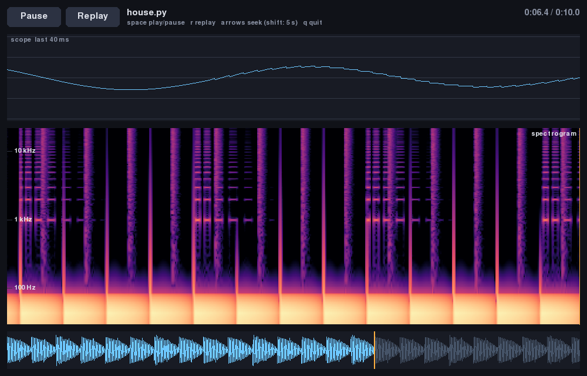
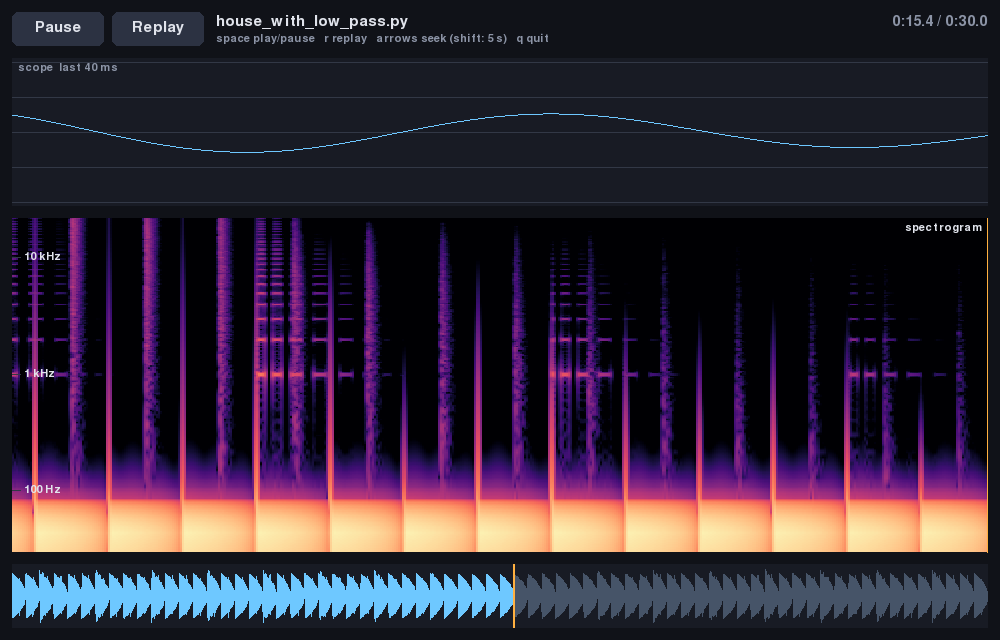
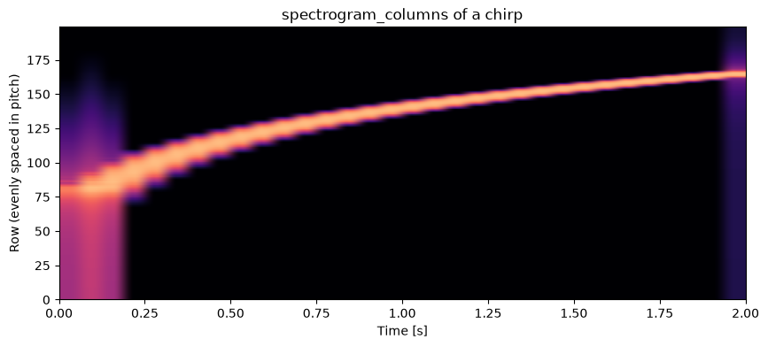

# Visualizing a signal

<!-- md-toc: -->
- [Controls](#controls)
- [Options](#options)
- [The numbers behind the picture](#the-numbers-behind-the-picture)
- [Playing a finished signal: `Player`](#playing-a-finished-signal-player)
<!-- md-toc: end -->

`visualize` opens a window that plays a signal and shows it as it plays: a scope
of the last few milliseconds, a spectrogram that scrolls with the playhead, and
a seek bar. It needs pygame, which the rest of the library does not
(`pip install 'daw[gui]'`; the dev shell has it).

```python no-run
from daw.waves.basic import sine
from daw.visualizer import visualize

visualize(sine(440), duration=5.0, title="A4")      # opens a window
```

The signal is compiled whole before the window opens, so everything works here,
including filters. The window itself looks like this:

```python
import runpy

import numpy as np

from daw.visualizer import snapshot

ns = runpy.run_path("../examples/house.py")
np.random.seed(0)    # the hat is noise: seed it so this picture is the same every run
snapshot(ns["w"], duration=10, at=6.4, title="house.py", playing=True,
         output_file="img/visualize-house.png")
```
<!-- md-code: id="visualize-house"; bin="python3"; timeout=120 -->



- **The scope** (top) shows the last 40 ms that were played, so a 40 Hz kick
  fills the panel with one slow wave and a 1 kHz tone with forty.
- **The spectrogram** (middle) has pitch going up and time going left to right,
  with the playhead at the right edge and about five seconds of history behind it.
  The rows are spaced evenly in pitch, so each octave is the same height. The
  brightness is loudness on a fixed scale (80 dB below a full-scale sine up to a
  full-scale sine), so a quiet passage looks quiet.
- **The seek bar** (bottom) outlines the whole signal; the part already played is
  blue and the playhead is orange.

## Controls

| Input | What it does |
| --- | --- |
| `space` or the **Play** button | Play and pause (from the end, plays again) |
| `r` or the **Replay** button | Start again from the beginning |
| `left`, `right` | Step back or forward one second (five with `shift`) |
| `home` | Go to the start |
| click or drag on the seek bar | Jump there; the sound pauses while you drag and carries on after |
| `q`, `esc` or closing the window | Quit |

Any other key is ignored. The window can be resized.

## Options

`visualize(expression, duration=10.0, sample_rate=44100, *, title, silent, autoplay, size)`

- `silent=True` shows the picture without making sound; the display then keeps the
  time itself. Useful on a machine with no speakers.
- `autoplay=False` opens paused.
- `size=(width, height)` sets the window size.

`snapshot(expression, duration, at, output_file, sample_rate, *, title, playing, size)`
draws the same window `at` seconds in and saves it as a PNG. It opens nothing and
makes no sound, which is how the picture above was made.

A filtered signal shows its filter at work. Here is `house_with_low_pass.py` at
15.4 s, the middle of its sweep. The five seconds of history start at 10 s, where
the filter begins to close, so reading left to right the treble of the hat and the
saw fades while the kick stays. The scope has nothing left but the kick:

```python
import runpy

import numpy as np

from daw.visualizer import snapshot

ns = runpy.run_path("../examples/house_with_low_pass.py")
np.random.seed(0)
snapshot(ns["w"], duration=30, at=15.4, title="house_with_low_pass.py", playing=True,
         output_file="img/visualize-filter.png")
```
<!-- md-code: id="visualize-filter"; bin="python3"; timeout=300 -->



## The numbers behind the picture

The drawing is built on a few functions in `daw.analysis` that you can use directly.

`spectrogram_columns(samples, sample_rate, rows=256)` returns an array of shape
`(columns, rows)` with values from 0 to 1. Column `k` analyses the 2048 samples
that end at sample `(k + 1) * 512`. Row `r` is the frequency
`frequency_of_row(r, rows, sample_rate)`, and `row_of_frequency` goes the other
way:

```python
import matplotlib.pyplot as plt
import numpy as np

from daw.analysis import frequency_of_row, row_of_frequency, spectrogram_columns

rate = 8000
t = np.arange(2 * rate) / rate
chirp = np.sin(2 * np.pi * (200 * t + 400 * t**2))      # sweeps 200 Hz up to 1800 Hz
grid = spectrogram_columns(chirp, rate, rows=200)

print("shape (columns, rows):", grid.shape)
print("bottom row:", round(frequency_of_row(0, 200, rate)), "Hz")
print("top row:", round(frequency_of_row(199, 200, rate)), "Hz")
print("the row for 1000 Hz:", round(row_of_frequency(1000, 200, rate), 1))

fig, ax = plt.subplots(figsize=(10, 4))
ax.imshow(grid.T, origin="lower", aspect="auto", cmap="magma", vmin=0, vmax=1,
          extent=(0, len(chirp) / rate, 0, 199))
ax.set(xlabel="Time [s]", ylabel="Row (evenly spaced in pitch)",
       title="spectrogram_columns of a chirp")
fig.savefig("img/visualize-chirp.png", dpi=100, bbox_inches="tight")
```
<!-- md-code: id="visualize-columns"; bin="python3" -->

Output:
```
shape (columns, rows): (32, 200)
bottom row: 30 Hz
top row: 4000 Hz
the row for 1000 Hz: 142.6

```
<!-- md-code-output: id="visualize-columns" -->



`peak_envelope(samples, width)` returns the lowest and highest sample in each of
`width` equal slices, which is what the seek bar draws:

```python
from daw.analysis import peak_envelope

low, high = peak_envelope([1, 5, 2, -3, 0, 4], 3)
print("lowest in each third: ", low.tolist())
print("highest in each third:", high.tolist())
```
<!-- md-code: id="visualize-envelope"; bin="python3" -->

Output:
```
lowest in each third:  [1.0, -3.0, 0.0]
highest in each third: [5.0, 2.0, 4.0]

```
<!-- md-code-output: id="visualize-envelope" -->

## Playing a finished signal: `Player`

`visualize` plays through a `Player` from `daw.live`: a finished signal that can be
played, paused and sought. `Player.render(count)` is what the sound card calls;
it hands out the next `count` samples while playing (silence when paused) and
moves the position on. The audio therefore sets the clock, and a display that
reads `player.position` is always in step with what you hear:

```python
from daw.live import Player
from daw.waves.basic import sine
from daw.waves.utils import compile

rate = 8000
player = Player(compile(sine(440), 2.0, rate), rate)
print("duration:", player.duration, "s, playing:", player.playing)

player.play()
player.render(4000)                      # half a second goes to the speakers
print("after half a second:", player.seconds, "s")

player.seek(1.5)
print("after seeking:", player.seconds, "s")

player.render(rate)                      # more than is left
print("finished:", player.finished, " playing:", player.playing)
```
<!-- md-code: id="visualize-player"; bin="python3" -->

Output:
```
duration: 2.0 s, playing: False
after half a second: 0.5 s
after seeking: 1.5 s
finished: True  playing: False

```
<!-- md-code-output: id="visualize-player" -->

A `LiveOutput` accepts any `Renderer`, which is anything with a `render(count)`
method that returns that many samples. A `Mixer` and a `Player` both are one.
